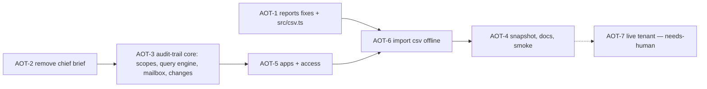

# Build Loop: admin oversight (reports + audit-trail)

**Spec:** tasks/specs/admin-oversight-spec.md (Step 1 reviewed 2026-10-17; Step 2 decisions E1–E5) · **Branch:** `build/admin-oversight` (off `main` at `595e92b`)
**Previous harnesses:** tasks/archive/.

## Resolved placeholders

| Placeholder | Value |
|---|---|
| `<TEST_CMD>` | `npm test` + `npm run typecheck` |
| `<RUN_CMD>` / `<SMOKE_SCENARIO>` | `node dist/index.js` / `scripts/smoke.sh` (14 checks) + new: `audit-trail import` on a fixture CSV offline (exit 0, aggregated rows, no subject text in output) |
| `<FULL_SUITE_BUDGET>` | ~7 s → full suite after every task |
| `<RUN_BUDGET>` | unbounded |
| `<REVIEW_MODEL>` | fable |

**Baseline (`595e92b` + spec commits):** 1664/1664 tests, tsc 0, smoke 14/0/0, docs:check clean.

## DAG



## Loops
- **Outer:** next ready task; wave 1 dispatches AOT-1 and AOT-2 in parallel (disjoint files: reports.ts/csv.ts/lint comment vs chief.ts/index.ts/catalog.ts/test MODULES); then serial.
- **Inner:** fail-first tests for behaviour changes; removal (AOT-2) gated by full suite + describe/MCP consistency. Orchestrator gates (suite + typecheck) in a separate step from the commit (lesson 7).
- **Meta:** lessons on correction only; spec/DAG updated on divergence.
- **Snapshot:** intermediate runs never use `-u`; regenerated once at AOT-4.
- **Smoke:** after AOT-3 and at AOT-4.

## Gates
- **Critical path: AOT-3** (the audit query engine every other audit-trail command uses). Extra proof: mocked async lifecycle (notStarted → running → succeeded; failed; cancelled; limit exceeded; timeout), and an **output allow-list property test**: fixtures whose `auditData` carries `Item.Subject`, `AffectedItems[].Subject`, `Folders[].FolderItems[].InternetMessageId` and recipients — no output format (json, table, csv, text) may contain any of those strings.
- AOT-1 privacy gate: differencing property test over several `--min-group-size` values (AO-22).
- No command added that reads message content; `access` requires `--app` or `--by`.
- No new npm dependencies (CSV parser is in-repo). Poison ceiling: 2 retries then BLOCKED; a blocked AOT-3 halts the run.

## Stop condition
```
DONE = AOT-1..AOT-6 DONE or BLOCKED-and-logged
       AND npm test + typecheck: no new failures vs the 1664 baseline
       AND every AO-* item addressed or under needs-human AOT-7
       AND smoke passes (incl. audit-trail import) AND docs:check clean
```

## Divergence log
- **2026-10-17 AOT-1:** dry-run snapshot updated in AOT-1 (not deferred to AOT-4), because intentional request-shape changes (`by-department` `$select` + `accountEnabled`) otherwise leave the gate red; AOT-4 still regenerates once at the end. Same diff pruned the two obsolete `chief brief` entries from AOT-2.
- **2026-10-17 AOT-1:** AO-23 coverage warning counts enabled accounts *with a department* missing from the report (the literal "all enabled users" would warn on every tenant with unlicensed/service accounts).
- **2026-10-17 after AOT-6:** real-export smoke found `appIdOf()` preferring `AppId` (the resource) over `ClientAppId` (the caller); `--app` matched nothing. Fixed with a fail-first test; real-file aggregates now match the manual 2026-10-17 analysis. Lesson 12.
