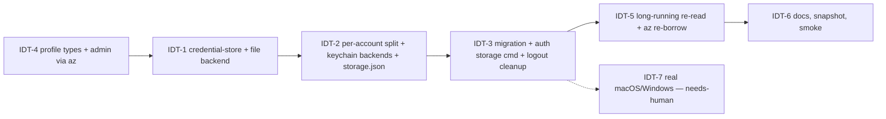

# Build Loop: identity profiles (user + admin, credential storage)

**Spec:** tasks/specs/identity-profiles-spec.md (Step 1 reviewed; Step 2 decisions E1–E4) · **Branch:** `build/identity-profiles` (off `build/chief-of-staff`)
**Previous harnesses:** tasks/archive/.

## Resolved placeholders

| Placeholder | Value |
|---|---|
| `<TEST_CMD>` | `npm test` + `npm run typecheck` |
| `<RUN_CMD>` / `<SMOKE_SCENARIO>` | `node dist/index.js` / `scripts/smoke.sh` (12 checks) + new checks: `auth storage show` reports the file store; a hanging stub keychain tool doesn't delay exit beyond its timeout |
| `<FULL_SUITE_BUDGET>` | ~6.5 s (measured: 1535 tests in 6.38 s) → full suite after every task |
| `<RUN_BUDGET>` | unbounded |
| `<REVIEW_MODEL>` | fable |

**Baseline (HEAD `009077d` + review commits):** 1535/1535 tests, tsc 0, smoke 12/0/0, docs:check clean. This machine: Linux/WSL, no D-Bus session, no `security`/`secret-tool`/PowerShell DPAPI → real behaviour is the file store; keychain backends are tested with stub tools on PATH.

## DAG (serial: every task touches `src/auth.ts`)



## Loops
- **Outer:** next ready task in DAG order; one subagent per task (scope = the task's files); the orchestrator gates (full suite + typecheck, separate step from commit) and commits per task.
- **Inner:** fail-first test for behaviour changes; behaviour-preserving refactors (IDT-1) are gated by the unchanged full suite + snapshot.
- **Meta:** lessons on correction only; spec/DAG updated on divergence.
- **Smoke:** after IDT-3 and in IDT-6.

## Gates
- **Critical path: IDT-2** (cache split/reassembly — every login depends on it). Extra proof: round-trip of a multi-account MSAL cache through split → store → reassemble (deep-equal), concurrent writers for different accounts under the lock (8 processes), and corrupt/missing item handling.
- IDT-1 is behaviour-preserving: the full suite and the dry-run snapshot must not change.
- No real keychain access in any test (tests force `MS365_CLI_STORAGE=file` or use PATH stubs).
- No new dependencies. Poison ceiling: 2 retries then BLOCKED; a blocked IDT-2 halts the run.

## Stop condition
```
DONE = IDT-1..IDT-6 DONE or BLOCKED-and-logged
       AND npm test + typecheck: no new failures vs 1535 baseline
       AND every ID-* item addressed or under needs-human IDT-7
       AND smoke passes (incl. the new storage checks) AND docs:check clean
```

## Divergence log
