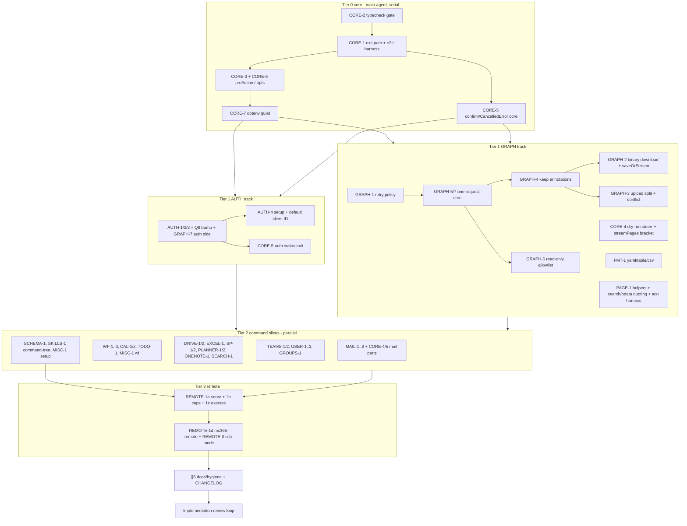

# Build loop — ms365-cli hardening

Spec: `tasks/ms365-cli-hardening-spec.md` (REVIEWED 2026-10-06). Branch: `build/ms365-cli-hardening`.
Resolved placeholders: `<TEST_CMD>` = `npm test` (vitest; becomes `tsc --noEmit && vitest run` at CORE-2) · `<RUN_CMD>` = `npm run build && node dist/index.js` · `<SMOKE_SCENARIO>` = §Smoke below · `<FULL_SUITE_BUDGET>` = ~2 s today (measured 1.8 s), re-measured per tier · `<RUN_BUDGET>` = unbounded · `<REVIEW_MODEL>` = invoking model, adversarial reviewer subagent.
Baseline (Step 0, commit `38dd3c7`): 5 files / 95 tests pass, 0 fail, 0 flaky. `tsc --noEmit`: 756 errors. Smoke signal today: `--dry-run calendar list -o json` exits **143** and stdout is not pure JSON.

## Task DAG

Every spec item maps to exactly one node (coverage table at end). REMOTE-2 / REMOTE-3 are "later" in the spec → out of scope, logged in `opportunities.md`. No needs-human items.

## Tracks / contention graph

| Track | Owned files | Shared-file rule |
|---|---|---|
| CORE (main) | `src/errors.ts`, `src/index.ts`, `src/utils.ts` (confirm), `src/logger.ts`, `test/e2e/*`, `package.json` scripts | tier 0 only, serial |
| AUTH | `src/auth.ts`, `src/commands/auth.ts`, `src/commands/setup.ts`, `src/index.ts` (getAuth wiring), `package.json` deps + lockfile, `test/auth*.test.ts` | sole owner of manifest/lockfile in tier 1 |
| GRAPH | `src/graph-client.ts`, `src/formatter.ts`, `src/utils.ts` (helpers), `test/graph-client.test.ts`, `test/formatter.test.ts`, `test/utils.test.ts`, `test/helpers/*` | no manifest edits |
| MAIL | `src/commands/mail.ts`, `src/mime.ts`, `test/commands/mail.test.ts` | |
| CALWF | `src/commands/{calendar,workflow,todo,contacts}.ts`, `test/commands/{calendar,workflow,todo,contacts}.test.ts` | |
| FILES | `src/commands/{drive,excel,sharepoint,planner,onenote,search}.ts`, tests | |
| ORG | `src/commands/{teams,user,groups}.ts`, tests | |
| META | `src/commands/{schema,generate-skills}.ts`, new `src/command-tree.ts`, tests | |
| REMOTE (main) | new `src/serve/*`, `src/remote.ts`, `tsup.config.ts`, `package.json` bin, `src/index.ts` registration | after tier 2 |
| DOCS (main) | `README.md`, `CHANGELOG.md` | last |

Edges: AUTH and GRAPH are disjoint (GRAPH-7: auth side owned by AUTH via the existing `getToken(forceRefresh)` contract; GRAPH only calls it). The five tier-2 slices are pairwise disjoint; each needs only tier-1 helper APIs. Implicitly shared: `package.json`, `package-lock.json`, `tasks/todo.md`, `README.md` → main agent only (slices report needed README edits in their result; DOCS applies them).

## Loops

**Outer loop (main agent).** Trigger: previous node merged. Step: pick ready nodes in tier order (spec §9); if ≥2 ready with disjoint tracks → parallel dispatch loop; else run inner loop inline. After each node: mark `tasks/todo.md`, meta loop. Exit: every node DONE or BLOCKED-and-logged.

**Inner loop (one task).** (1) Read the spec item + cited lines. (2) Behavior change → write the failing regression test first, observe it fail. (3) Implement. (4) Full gate: `npm test` (typecheck + vitest, whole repo). (5) Self-review checklist: diff confined to task files; no new TODO/dead code; no secret values in any file (file:line refs only; `.env:1` holds a third-party key — never copy it); reuse existing helpers/deps before writing new ones; no speculative abstraction; matches the file's existing patterns; diff size proportionate. (6) Commit: `git commit -m "<ID>: …" -- <paths>`.

**Parallel dispatch loop.** Trigger: ≥2 ready nodes in disjoint tracks (tier 1: AUTH ∥ GRAPH; tier 2: MAIL ∥ CALWF ∥ FILES ∥ ORG ∥ META). Each subagent works in its own git worktree `/tmp/ms365-wt/<track>` on branch `slice/<track>` (node_modules symlinked), commits only its paths, runs the full gate inside its worktree, never edits manifest/lockfile/README/tasks files. Main merges each slice branch into the build branch (`git merge --no-ff`), runs the full gate after each merge, then removes the worktree.

**Meta loop.** After each node, or on any failure/correction: append mistake → rule to `tasks/lessons.md` (only on corrections); update spec/DAG if reality diverged; newly found defects with no task → `tasks/opportunities.md`, never silently fixed (exception: minimal refactor inside already-touched files, no public interface change).

**Full-suite regression loop.** After each tier merge: `npm test` + `npm run build`. Compare with baseline (95 pass; after CORE-2 the gate includes `tsc`). New failure → triage per skill rule (tally across gate logs; 3× re-run through `npm test`; deterministic blocks). Known-failure list: *(empty)*.

**Smoke loop.** Once per tier, ≤60 s timeout per step, in `mktemp -d` with `HOME=$tmp/home`, `env -i PATH=$PATH` (no repo `.env`):
1. `node dist/index.js --dry-run calendar list -o json` → exit 0, stdout `JSON.parse`s. (fails at baseline: 143 + mixed stdout)
2. `node dist/index.js mail list -o json` (no login) → exit 1, stderr names `ms365 auth login`.
3. `node dist/index.js schema mail.list -o json` (no client ID) → exit 0, JSON. (from tier 0)
4. (tier 3+) `ms365 serve --socket $tmp/s.sock --app-cap example.com/cap/ms365` in background; `curl --unix-socket` `GET /v1/health` → 200; `POST /v1/execute {"command":"mail.list","args":{"dryRun":true}}` without caps header → 403; with caps `mail.read` → 200 `ok:true`; `ms365-remote` (TCP fallback: `serve --port` behind a small node proxy that adds the `Tailscale-App-Capabilities` header, standing in for `tailscale serve`) `--dry-run calendar list -o json` → exit 0, stdout JSON. SIGTERM serve directly → exit 0, socket file removed.
Afterwards `git status --short --ignored` shows nothing new beyond `dist/`, `node_modules/`.

**Re-plan loop.** Trigger: a node's attempt fails or reveals spec divergence. Step: diagnose, update the spec item with `[REVISED: …]`, adjust DAG; retry. Poison ceiling: attempt 3 fails → BLOCKED, dependents BLOCKED; critical-path BLOCKED → stop run and report.

**Implementation review loop.** Trigger: all nodes DONE. Read-only adversarial reviewer vs finished code + spec acceptance. Each finding reproduced (fail-first test or observed output) before fixing; dispositions (fixed / invalid+evidence / rejected+reason) go into the end-of-run report.

## Critical path + extra gates
- **CORE-1** (every command exits through it): e2e test spawns the *built* binary (temp cwd/HOME, scrubbed env) and asserts exit 0 / 1 / 1 for dry-run / not-logged-in / usage error, plus a ≥1 MB stdout completeness check and `| head -1` clean exit.
- **AUTH-1/2** (token persistence): e2e/integration proof with a fake MSAL client: headless save writes the cache file 0600 in a 0700 dir; 10 concurrent writers leave a parseable file; silent refresh persists.
- **GRAPH-4** (response shape every command reads): invariant check — formatter output for all existing formatter fixtures byte-identical before/after, and `response.data` consumers grep-audited.

## Verification bar
Behavior change → failing test first. Behavior-preserving (CORE-2 signature, Q8 bump) → baseline comparison only. Failure-path tests assert recovery on the next call where meaningful.

## Stop condition
All nodes DONE/BLOCKED-logged ∧ full suite no new failures vs baseline ∧ every spec item addressed ∧ smoke steps 1–4 pass ∧ implementation review run with dispositions recorded.

## Coverage (spec item → node)
CORE-1,2,3,6,7 → T0 · CORE-5 → T0 (confirm), AUTH (auth status), MAIL (batch) · CORE-4 → GRAPH (dry-run, streamPages), MAIL/CALWF (empty states) · AUTH-1..4 → AUTH · GRAPH-1..7, FMT-1, PAGE-1 helper, MAIL-8/GROUPS-1 quoting helper → GRAPH · PAGE-1 adoption → each slice · MAIL-1..8 → MAIL · WF-1..3, CAL-1/2, TODO-1 → CALWF · DRIVE-1/2, EXCEL-1, SP-1/2, PLANNER-1/2, ONENOTE-1, SEARCH-1 → FILES · TEAMS-1/2, USER-1..3, GROUPS-1 → ORG · SCHEMA-1, SKILLS-1 → META · MISC-1 → CALWF (workflow parts), AUTH (setup re-prompt), GRAPH + FILES (upload progress via `info()`) · REMOTE-0, 1a–d → T3 · §6 docs/deps → DOCS (+ AUTH for deps) · REMOTE-2/3 → out of scope (spec: later).
