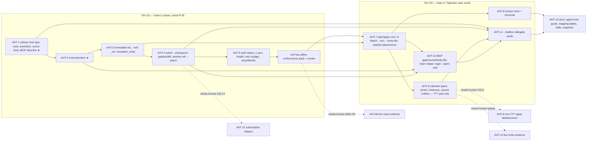

# Build Loop: agent-host integration (AH- / AHT-)

**Spec:** tasks/specs/agent-host-integration-spec.md (Step 1 + Step 2 done 2026-10-17, f1cc32c; Step 3 decisions E1–E8 below) · **Branch:** `build/agent-host-integration` (off `origin/main` 2be3fce)
**Previous harnesses:** tasks/archive/ (admin-oversight-run archived by this run).

## Resolved placeholders

| Placeholder | Value |
|---|---|
| `<TEST_CMD>` | `npm test` + `npm run typecheck` (+ `npm run docs:check` for tasks that add options/commands) |
| `<RUN_CMD>` / `<SMOKE_SCENARIO>` | `node dist/index.js` / `scripts/smoke.sh` (15 checks today) + AHT-6a host-mode checks, all offline: `type: host` profile ceiling refusal under `--dry-run` → exit 4, last stderr line `{"error":{"code":"scope_ceiling"}}`; `describe --json` lists `--refs`, `watch --checkpoint`/`--select`, `health`, `auth status -o`; `auth status -o json` with an env JWT → `source:"external"`, no MSAL load; `watch mail --checkpoint new` against a fetch-stub preload → last line `type:"checkpoint"`, no `watch/` dir. Signals = exit code + parsed JSON field. |
| `<FULL_SUITE_BUDGET>` | measured 6.5 s (`npm test`, 1784 tests) + 0.24 s tsc + 0.23 s docs:check → full gate after every task |
| `<RUN_BUDGET>` | unbounded |
| `<RELIABILITY>` | Fastest at 90 % (default option, not chosen by the user) |
| `<REVIEW_MODEL>` | invoking model (self-review, adversarial) — Step 1 was done by the spec reviewer |

**Baseline (2be3fce + spec commits, Node 24.21.0):** `npm test` 58 files / 1784 tests passed, 6.0 s (6.5 s wall); `tsc --noEmit` 0 errors (0.24 s); `docs:check` clean (0.23 s); `scripts/smoke.sh` pass=15 fail=0 skip=0 (6.1 s incl. `tsup` build). Known-failure list: empty.

## Dev-loop cost baseline
One change lands for ≈ 8 s of local CPU (suite + tsc + docs:check); smoke ≈ 6 s. No GPU, device or CI runner. The only scarce resources are (a) the live tenant + Chief's Entra app + the principal's time (needs-human, excluded: AHT-6b/AHT-14) and (b) this single agent's serial attention (R-35: G2 tasks share `index.ts`, `profiles.ts`, `commands/auth.ts`, `formatter.ts`, `watch.ts`). Spawned-entry tests (≈ 0.6 s each through tsx) are capped at 12 new for the AH subset.

## Plan options
| Option | Wall time | P(inside range) | P(real problem slips) | Slip cost |
|---|---|---|---|---|
| **Fastest @90 % (active)** | 7–11 h [INFERENCE] | ~70 % | ~10 % | found by Chief's MSC wrapper or the AHT-6b live run; ≈ 1–2 h to fix |
| Balanced | 8–12 h [INFERENCE] | ~70 % | ~5 % | as above, rarer |
| Most reliable | 9–14 h [INFERENCE] | ~65 % | ~2 % | as above, rare |
- Fastest: suite+tsc every task, docs:check on option changes, smoke once per tier, one implementation review at the end.
- Balanced: Fastest + an extra adversarial review after AHT-1/AHT-2 (critical path).
- Most reliable: smoke + docs:check every task, adversarial review per tier, fail-first re-proved for every AC.

## Task DAG


★ = critical path. Execution order (topological, spec priority G2 first): AHT-1 → 2 → 3 → 4 → 5 → 6a → 7 → 8 → 9 → 10 → 11 → 13. Self-check: 12 buildable nodes, every non-needs-human AHT item exactly once (AHT-6 split a/b, AHT-9 split TTY/non-TTY), acyclic (the order above is a valid topological sort).

## Track / contention graph
All tracks share implicitly: `src/catalog.ts`, `README.md` (generated), `test/__snapshots__/snapshot.test.ts.snap`, `tasks/*`. Per-task files: AHT-1 `index.ts, profiles.ts, catalog.ts, ceiling.ts(new), formatter.ts, mcp-server.ts, describe.ts`; AHT-2 `index.ts, profiles.ts, auth.ts, commands/auth.ts, errors.ts, graph-client.ts, external-token(new), child-env(new), grant-scopes.ts, keychain.ts, setup.ts`; AHT-3 `graph-client.ts, formatter.ts, mail.ts, calendar.ts, watch.ts, workflow.ts, refs(new)`; AHT-4 `watch.ts`; AHT-5 `commands/auth.ts, health(new), graph-client.ts, errors.ts`; AHT-7 `mail.ts, calendar.ts, plan(new), apply(new)`; AHT-8 `mail.ts, idempotency.ts`; AHT-9 `calendar.ts`; AHT-10 `mcp-server.ts, auth.ts, commands/auth.ts`; AHT-11 `mail.ts, calendar.ts, watch.ts`. No pair of ready tasks is disjoint once `catalog.ts`/README/snapshot are counted → **parallel dispatch loop disabled** (E4); one agent, serial.

## Loops
- **Outer:** take the next node in the order above whose dependencies are DONE and that is not needs-human; run the inner loop; mark DONE in `todo.md`; re-evaluate.
- **Inner (one task):** read the touched code → fail-first tests for each behaviour change (run only the task's test files) → implement → task tests green → orchestrator gate in a separate step: `npm test` + `npm run typecheck` (+ `docs:check`, `npm run docs` to regenerate when options changed) → self-review checklist: diff confined to the task's files; no TODO/dead code; no secret/real address/tenant id/token in any file (role refs only; test JWTs are synthetic); reuse existing helpers (`scopeSatisfied`, `tokenInfo`, `writeFileAtomic`, `printList`, `runCommand`, ledger) before new code; no speculative abstraction; matches the touched file's pattern; diff size proportional → commit with explicit paths (`git commit -m … -- <paths>`) → `chown -R cklaus:cklaus` the repo.
- **Meta:** on any correction/failure append mistake → rule to `tasks/lessons.md`; on divergence update the spec (`[REVISED: build …]`) and the divergence log below. A rule firing twice becomes a mechanism (script/guard test).
- **Full-suite regression:** after every task (the gate costs ≈ 8 s), compared with the 1784/1784 baseline. A new failure blocks unless it is on the known-failure list (empty) via the skill's tally + 3× re-run-through-gate procedure.
- **Smoke/integration:** once per tier (after AHT-6a and after AHT-13): `scripts/smoke.sh` (builds `dist/`, runs in a mktemp dir, 30 s per check), then `git status --short --ignored` must show nothing new beyond `dist/`, `node_modules/` and the owner's untracked files. MCP long-lived server behaviour (AHT-10) is covered in-process by `test/mcp.test.ts` with the injectable `Runner`.
- **Implementation review:** when every buildable node is DONE, one read-only adversarial reviewer against the finished code and ACs 1–32; each finding reproduced (fail-first test or observed output) before acting; dispositions recorded in the end-of-run report.
- **Dev-loop cost:** per tier, split agent time into implementing / gate-waiting / rework; the largest non-useful share gets an action or an `opportunities.md` entry with numbers.
- **Re-plan:** a task whose diff grows past ~2× its expected size, or whose 2nd attempt fails, is re-scoped in the spec before attempt 3.
- **Contract loop:** any change to the cross-spec contract (spec line 286) is sent to `agent://BuildMsc` with the exact change and recorded as `[REVISED: build …]`; changes received from BuildMsc are applied in the next task boundary.

## Gates
- **Critical path: AHT-1 (ceiling) and AHT-2 (external token source).** Everything Chief relies on sits on them (host profile, `scope_ceiling`, `token_*` codes; AHT-5 health `uses`, AHT-7 apply re-check, AHT-11 `.Shared` selector). Extra proof: (a) a property test over **every** catalog path × a family of ceilings: the check refuses iff some `uses` clause has no scope satisfied by the ceiling, and adding scopes to a ceiling never turns an allowed command into a refused one (monotonicity); (b) end-to-end through the real entry: refusal makes zero fetch calls with `MS365_CLI_PREFLIGHT=0`, an opaque token and `--dry-run`; (c) AHT-2: external mode never loads MSAL and leaves the config dir unchanged (file-list diff), and every refusal code makes zero fetch calls. A BLOCKED AHT-1 or AHT-2 halts the run.
- **Dry-run snapshot:** changes only in AHT-3 (immutable-id header) and wherever a task adds a request-shape change it names; never `-u` blindly — diff read first.
- **Dependency hygiene:** no new npm dependency (JWT decode, sha256, canonical JSON all from `node:crypto`/in-repo).
- **Gate cost budget:** suite ≤ 15 s (spec), smoke ≤ 60 s. Above 2× → review before re-running.
- **Statistical gates:** none in this spec (no sampling gate).
- **Skip unchanged inputs:** smoke skipped when the `dist/` sha256 equals the last green run's.
- **Poison-task ceiling:** attempts 1–2 diagnose/re-plan; attempt 3 fails → BLOCKED, dependents blocked, logged.
- **Resumability:** commits are the source of truth; `todo.md` is derived from `git log --grep '^AHT-'`.

## Stop condition
```
DONE = AHT-1..5, 6a, 7, 8, 9 (TTY part), 10, 11, 13 DONE or BLOCKED-and-logged
       AND npm test + typecheck: no new failures vs the 1784 baseline; docs:check clean
       AND every AH-* item addressed or tagged needs-human (AHT-6b, AHT-9 non-TTY/OQ-8, AHT-12/OQ-14, AHT-14)
       AND scripts/smoke.sh passes with 0 FAIL / 0 SKIP incl. the AHT-6a host-mode checks
       AND the implementation review ran, every disposition recorded
```

## Known-failure list
(empty)

## Divergence log
- AHT-3: the dry-run snapshot did not churn (it excludes `Headers:` lines), unlike the Gates note expecting immutable-id churn.
- AHT-4: the snapshot's `watch` optional-flags run became exit 2 (`--checkpoint` + `--name` conflict, by design); E10/E11 added.
- AHT-5: `health` ceiling clause `User.Read` only; out-of-ceiling resources in-band `UNSUPPORTED scope_ceiling` (E12; BuildMsc acked). Record value sources fixed (E13). `test/helpers/cli.ts` routes may now be async and see the abort signal.
- AHT-6a: smoke 15 → 32 checks (7.9 s); fail-first on the pre-AHT-5 dist: 10 FAIL. Conformance digest printed per run; the pinned digest is the one recorded at the end of the run.
- AHT-7: `payload` uses Graph field names, not Chief's schema (E15, schema not local). `--body-file` satisfies a mandatory `--body` through commander `implies`; the snapshot's optional-flags runs skip `--body-file`. `--if-match` also landed on `calendar update/delete` (AC20 names them; plan support for calendar stays AHT-9). Fail-first: `test/plan.test.ts` on 6c78b80 fails (no `apply` module).
- AHT-8: `mail send` goes through the draft path for every caller, not only agent hosts (one path; E18), so its ceiling `uses` gains `Mail.ReadWrite`. Outbox matches map to `NOT_FOUND_YET` with evidence (the three-state contract stays). `mail send/reply/forward` became plan-capable here (AH-5(1)); reply/forward plans bind the original without If-Match (E19). `describe --json` gained `plan` and `providerIdempotency`; `generate-skills` now reuses describe's builders. Fail-first: `test/send-outcome.test.ts` on 290415b: 9 of 11 fail.
- AHT-9: TTY part only (OQ-8 needs-human): `apply` asks for calendar delete/cancel and exits 7 without a TTY (E22). "Host plan" defined as external-token mode (E21). `calendar create` also became plan-capable (AH-5(1) lists it; not in the AHT-9 row). `apply` re-catalogued `delete` for the confirm() guard. Update now always GETs once (two old tests asserting "no read" were rewritten). Fail-first: `test/calendar-plans.test.ts` on 7aa90fc: 13 of 13 fail.
- AHT-10: argv via temp file for every MCP call, not only >1KB strings + `--body-file` (E23); watch resumption supersedes F10 (E23). `MS365_CLI_TOKEN_COMMAND` also counts as external mode and a second 401 is `token_rejected` (E24). Device-code `--wait` gained a `failed` state; AC 17 runs the holder in-process because MSAL's HTTP client bypasses the fetch double (E25). The `runCommand` fake auth gained `tokenSource()`. Fail-first: on 0a6ee5d the new tests in `test/{device-login,external-token,mcp}.test.ts` fail (8 failures incl. the unloadable device-login file).
- AHT-11: `.Shared` is an added clause, not a replacement for the own read scope (consistent with the existing `resolve --user` selector; E26). `watch files|contacts --mailbox` is a usage error. Fail-first: `test/delegate-reads.test.ts` on a0f2680: 5 of 6 fail (the blank-value case already exited 2 as an unknown option).
- AHT-13: most of the guide had already landed per task in the generated shared skill (`docs-gen.ts`, "Host-supplied tokens and scope ceilings", with the `_ref` and health mapping tables), so AHT-13 added the README map (`## Agent hosts`, 7 steps pointing at the skill) and fixed stale README text found on the way: "Bring your own token" showed `MS365_CLI_TOKEN` in `.env` (refused since AHT-2), retries said "up to 3" (2 since AH-8(6)), and the env table lacked the AH variables. The command table now prints a delegate read as `Mail.Read (--mailbox: + Mail.Read.Shared)`. Skills are generated on demand, not tracked: regenerated into a temp dir from the built `dist/` (33 files) to check they render; the dry-run snapshot had no further churn after AHT-11. No fail-first (docs only).
- Smoke: the G3 tier ran no smoke until the end (per plan: once per tier). The end-of-run smoke caught a stale check: `dry-run mail send trace` still expected `POST /me/sendMail`, but AHT-8 moved every send to the draft path (`POST /me/messages` then `…/DRAFT_ID/send`). The check was updated to the two-request trace (no product change); it had been failing since AHT-8.
- Implementation review: 3 P1 fixed with fail-first tests, 4 P2 fixed, 2 P2 deferred (dispositions below); E27 added.

## Implementation review (reviewer agent, adf2d12..6fe25f4, read-only)
| # | Sev | Finding | Disposition |
|---|---|---|---|
| 1 | P1 | `apply` decides the ceiling and the delete/cancel confirmation from the plan's self-declared `command`; a hand-written plan (digest recomputed over the file) could relabel a `/send` or `DELETE /me/events/…` | **Fixed** (E27): `requestCommand()` in `plan.ts` maps each request to the plan command that sends it; ceiling over all of them; confirmation when any is delete/cancel; other shapes `plan_invalid`. Fail-first: new `plan.test.ts` case fails on 6fe25f4 |
| 2 | P1 | Failed window roll under `--follow` adopted the new window and dropped the cursor before the backfill, so the retry silently re-baselined | **Fixed**: roll state adopted only after the backfill succeeds. Fail-first: new `watch-checkpoint.test.ts` case fails on 6fe25f4 |
| 3 | P1 | `mailFolders('…')` deltaLinks skipped `Prefer: IdType="ImmutableId"` and `_ref` | **Fixed**: `outlookPath` matches the segment name without its `('key')`. Fail-first: extended `watch-checkpoint.test.ts` case fails on 6fe25f4 |
| 4 | P2 | MCP parent kept a helper token Graph rejected | **Fixed**: `CallEnv.drop`; spawnRunner drops the token after a child's `token_rejected` |
| 5 | P2 | `auth login --start` timeout left the holder running (it could rewrite the handle file) | **Fixed**: `spawnHolder` returns a stop function, called before the handle file is removed |
| 6 | P2 | Plan file written in place, then chmod (an existing 0644 file or symlink exposed the body briefly) | **Fixed**: new 0600 temp file (`wx`) renamed into place |
| 7 | P2 | `search_cap` not reported across `--cursor` pages (count is per page) | **Deferred** → opportunities (needs the running count inside the cursor; cursor format change) |
| 8 | P2 | A send applied from a plan has no `correlation`, so `mail reconcile` cannot resolve a lost `/send` | **Deferred** → opportunities (AH-6 reconcile covers `mail send --idempotency-key`; plan-applied send correlation is new scope; README says so implicitly) |
| 9 | P2 | Inline casts for member access in `formatter.ts`, `graph-client.ts`, `refs.ts`, `watch.ts` | **Fixed** with `Reflect.get`/`Reflect.set` (the validated `parsed as Checkpoint` return stays) |

## Final status
- Gate: `tsc` 0 errors; `vitest` 68 files / 1970 tests passed (baseline 58 / 1784; 0 new failures); `docs:check` clean (230 commands).
- Smoke: `scripts/smoke.sh` pass=32 fail=0 skip=0 (≈ 8 s); pinned conformance signal `conformance: dist sha256=58f4c44fb0fbd5066dc4dc41650fb9fd7c93f1fe1742b985b2f5235ec689282e` (dist built from the final source).
- Estimate vs actual: Fastest 7–11 h [INFERENCE] vs ≈ 2 h 10 min by commit clock (adf2d12 16:16 → review fixes ≈ 18:25).

---

# Follow-up run 2026-10-17: AHT-15 contract fixture + AHT-9 non-TTY apply (owner decisions OQ-8 b, D12)

Steps 0–2 done upstream (owner decisions recorded in the spec, 8a438f4). Branch `build/agent-host-integration` (PR #3), head 8a438f4.

| Placeholder | Value |
|---|---|
| `<TEST_CMD>` | `npm test` + `npx tsc --noEmit` + `npm run build` + `bash scripts/smoke.sh` (`docs:check` when options change) |
| `<SMOKE_SCENARIO>` | `scripts/smoke.sh` (32 checks) + new: `contract fixture` (AHT-15), `apply delete non-TTY host` / refusal rows (AHT-9) |
| `<RELIABILITY>` | Most reliable for AHT-9 (⚠ production-level: it relaxes a deliberate destructive-command prompt); full gate per task |
| Baseline (8a438f4, Node 24.21.0) | `npm test` 68 files / 1970 passed (4.9 s wall); tsc 0; smoke pass=32 fail=0 skip=0; dist sha256 `58f4c44f…282e` |

**DAG:** AHT-15 (contract fixture) → AHT-9b (non-TTY apply of approved delete/cancel). AHT-9b changes `apply`, not any fixture shape; the order only follows the owner's priority and the cross-agent contract (ChiefFollowups builds MSC-020 on AHT-15). Serial: both touch `scripts/smoke.sh`, `README.md`, `tasks/*`.

**Critical path:** AHT-9b. Extra gate: every OQ-8 refusal case has a fail-first test that asserts exit code, error code **and an empty request log** (in-process `calls` or the fetch-stub `[fetch]` log); the interactive path keeps its existing test unchanged.

**Cross-agent:** after the AHT-15 commit, message `agent://ChiefFollowups` with the commit, `test/fixtures/contract/` and the manifest format.

## Follow-up run results (2026-10-17)

| Task | Commit | Gate (vs baseline 68 files / 1970, smoke 32) |
|---|---|---|
| AHT-15 contract fixture | 9a3773c | 69 files / 1974 passed; tsc 0; smoke 33/0/0; docs:check ok |
| AHT-9 non-TTY apply (OQ-8 b) | 6a5a47a | 69 / 1980; tsc 0; smoke 36/0/0; docs:check ok |
| Implementation review fixes | see git log | 69 / 1981; tsc 0; smoke 36/0/0; docs:check ok |

**Implementation review (reviewer agent, 2026-10-17), dispositions:** (1, major) host path trusted the coarse `requestCommand` → fixed: exactly one request, the exact DELETE/POST `/cancel` path of `payload.eventId` = `target.id` (E29 (3)), 7 forge tests; the classifier itself → opportunity P2. (2, minor) series-scope plan applicable unattended → fixed: scope must be `single`/`occurrence`. (3, minor) `mcp serve` tool call took the host path → fixed: refused under `MS365_CLI_MCP=1` (exit 7), tested. (4, minor) manifest `commit` provenance → fixed: `dirty` flag + final manifest-only regeneration on the committed tree. (5, nit) README exit-code list → fixed. (6, nit) partial identity untested → fixed (`tenant only` forge); `--profile` over env precedence → smoke check 24 now sets `MS365_CLI_PROFILE` to the host profile while `--profile ceo-user` is refused.

**Fail-first evidence:** AHT-15: tamper test (changed byte, missing file, stray file) and the check fails on the AHT-9 description change before regeneration (smoke `contract fixture` FAIL observed). AHT-9: 4 of 6 new tests red on 8a438f4 code; the refusal tests that pass on the old (refuse-everything) code are proven by mutation — disabling each guard (profile, MCP, request path, single request, target, scope, identity `||`→`&&`) turns its test red (lesson 17). The `!PLAN_CONFIRM[plan.command]` clause survives mutation (the method/path check already implies it); kept as the explicit invariant.

**Owner-only (not done):** live-tenant evidence of a host-approved delete/cancel is AHT-14 (Gate 3, dedicated test mailbox; owner runs consent and sign-in). Node 22 contract reproduction is CI-only here (no Node 22 installed).

**Final dist sha256 (pin for Chief runners):** `d0d5e7148e161b73144a76db993d9d96b78ee863821158d655d1ce679793fd97` — built from 1e86c6e; the manifest-only commit after it does not change `dist/`, so the branch head builds the same digest. `test/fixtures/contract/manifest.json` names `commit: 1e86c6e`, `dirty: false`.

## Merge of origin/main (PR #4) into PR #3 (2026-10-17)

Merge 32bf6f6 (`git merge --no-ff origin/main`, ebfbd0b). Conflicts kept both sides: `GraphClientOptions` has `refs` (AH-3) and `orgMode` (#4); the external-token 401 → `token_rejected` path (AH-2) stays ahead of `graphError`, which gains `{orgMode}` and keeps `retryAfterMs` (AH-8); `getClient` passes both; opportunities keeps both lists. No AH guarantee changed (the #4 hint only edits a 403 message; codes, exit codes, ceiling, host profile and non-TTY apply are untouched; contract fixture bytes identical). 1376a00 freezes the clock in the owner's PR #4 clamp test (time-boundary race on main CI).

Gate after merge: 70 files / 1986 passed; tsc 0; smoke 36/0/0; docs:check ok; contract:check ok (25 files unchanged).

**Final dist sha256 (pin for Chief runners):** `ea8671a5e5b34e30b7256ff9f53f4cfd2991b33ad99520100c5947349ce46e60` — built from 1376a00; `manifest.json` names `commit: 1376a00`, `dirty: false`; only the manifest's `ms365` block changed.

## E30: mail baseline bound and page size (2026-10-17)

Chief's first real read timed out on the `watch mail --checkpoint` baseline (owner's inbox, 721 s, two Graph 504 retries, default page size). Owner choice: 90 days, bigger pages, 30-min sync. 866bbff adds `watch mail --received-since <time>` (mail only; `$filter=receivedDateTime ge` on the initial delta request, carried in the named cursor and the checkpoint blob; resume with another bound = `checkpoint_mismatch`, a named cursor with another bound = usage error) and asks Graph for 200-item delta pages (`Prefer: odata.maxpagesize=200`). 8194500 regenerates the contract fixture (`describe.json` only). Chief consumes it as feature `watch_received_since` and owns the 30-min baseline call.

Measured on megapc against the owner's inbox (`--checkpoint new`, no state written): default pages, whole folder 721 s; 200-item pages, whole folder 121 s; 200-item pages + `-90d` 8 s (3 289 items, one checkpoint).

Gate: 1993 passed; tsc 0; smoke 36/0/0; docs:check ok; contract:check ok.

**Final dist sha256 (pin for Chief runners):** `19be41bbf5be411c5cfefc559f9e5a18d6379253587896f65c9c81b4030a2db1` — built from 866bbff (8194500 changes only the fixture); `manifest.json` names `commit: 866bbff`, `dirty: false`. Installed at `/opt/ms365/8194500` on gpumaster and megapc (`dist` tree identical to this digest on both).

## E31: key-form cursor paths (2026-10-18)

Chief's shadow brief pages `mail list --folder sentitems`; page 2 always exited 2 `cursor_mismatch` on megapc. Cause: Graph's `@odata.nextLink` names the folder in OData key form (`/v1.0/me/mailFolders('sentitems')/messages`, likewise `inbox`), and `decodeCursor`'s `graphPath` compared it literally against the command's own `/v1.0/me/mailFolders/sentitems/messages`, so every keyed page after the first was refused. 7e0c2c5: `graphPath` rewrites a key-form segment `name('value')` to `name/value` after percent-decoding and before lower-casing (Graph folder ids are base64url, never `'`). AH-1(7) unchanged: another folder, resource or API version is still `cursor_mismatch`. 70fb13f regenerates the contract manifest only (`commit`, `distSha256`).

**Fail-first evidence:** `cursor binding (AH-1(7), AC 28) > mail list --folder sentitems: a key-form nextLink cursor (mailFolders('sentitems')) is accepted; another folder is cursor_mismatch` is red on c947619's `formatter.ts` (exit 2 on the `mailFolders('sentitems')` page-2 cursor) and green after; the same test keeps `mailFolders('inbox')` for `--folder sentitems` at exit 2 with zero fetch calls, and a `beta` key-form cursor `cursor_mismatch`.

Gate: 70 files / 1994 passed; tsc 0; smoke 36/0/0; docs:check ok; contract:check ok (25 files unchanged).

**Final dist sha256 (pin for Chief runners):** `cb84ed9fd2aed0eb9dc19629a386670e86c44155a2d0ccee53dd507d76ff8a0a` — built from 7e0c2c5 (70fb13f changes only the manifest); `manifest.json` names `commit: 7e0c2c5`, `dirty: false`. Installed at `/opt/ms365/70fb13f` on gpumaster and megapc (clean `git archive`, build, one `npm ci --omit=dev`; read-only; trees identical on both). Runner wrapper `identify` on megapc: `ms365_dist_sha256` `baad03e915e10f8652c5531d435d6de42dd8f644e832600e5c933755c9a4d574`, `ms365_deps_sha256` `9b6edb752c0d7ee83897bf4dd237d6837ccf4b628e7342471b0722f5d25197ef` (deps equal to 8194500's).

## E32: chat list --recent for Chief's Teams brief (2026-10-19)

Chief's Teams brief (Chief `tasks/teams-brief-spec.md`, TMS-1..4) needs the CEO's recently active chats with their last message, and a contract sample for each Teams read it parses. Cause: `chat list` returned `/me/chats` in Graph's default order without `lastMessagePreview`, took no content options and marked nothing untrusted (a chat's topic and member names are settable by anyone in it), and the contract fixture had no Teams sample and no profile-less `describe`. 7437edb: `chat list --recent` requests `$expand=lastMessagePreview` and `$orderby=lastMessagePreview/createdDateTime desc` (with `-o table` the expand is `members($select=displayName),lastMessagePreview`); without `--recent` the request is unchanged. `chat list` takes `--body`/`--max-chars`/`--wrap-untrusted` through its own transform (`chatTransform`, `content.ts`): `shapeBodies` on the nested `lastMessagePreview`, `--body none` drops its body, every chat item `untrusted: true`, no `/organization` lookup; scopes unchanged (`Chat.Read`). `scripts/contract.mjs` adds four cases run without a profile and with a Teams-scoped token: `describe-unfiltered.json`, `chat-list-recent.json` (the stub answers only the `--recent` query; nextLink, so `complete:false`), `chat-messages.json` (an @mention from another tenant, a system message with `messageType: unknownFutureValue` and no `from`; nextLink) and `channel-messages.json` (`channelIdentity`, `webUrl`, edited message; complete). The 25 existing samples are byte-identical; d742a2c regenerates the manifest only (`commit`, `dirty: false`). Both sit on c8f9ce6, the rewritten origin E31 record (same tree as c0ab703).

**Fail-first evidence:** `chat list --recent and content options (TMS-1, TMS-2)` in `test/commands/teams.test.ts`: on the E31 `teams.ts` 4 of 5 red (no `$expand=lastMessagePreview`/`$orderby`, no table expand, no `untrusted`, preview body not shaped or dropped), all green after; the fifth (`without --recent the request is unchanged`, exact `/me/chats?$top=5` and `/me/chats?$top=5&$expand=members($select=displayName)`) is green on both, which is the byte-identity proof. The one-request assertion pins "no `/organization` lookup".

Gate: 70 files / 1999 passed; tsc 0; smoke 36/0/0; docs:check ok; contract:check ok (29 files unchanged).

**Final dist sha256 (pin for Chief runners):** `28a8e0e7a2cc3f2adeb2214a20b234e7c0a77a126759447961b8010bf3ebd893` — built from 7437edb (d742a2c changes only the manifest); `manifest.json` names `commit: 7437edb`, `dirty: false`, manifest sha256 `c4656d43564f064d0ee89107be7e83065ef0eb48cc6872b89b7b1af38b69f343`. Install tree: clean `git archive 7437edb`, `npm ci`, build, one `npm ci --omit=dev` (dist digest unchanged by the prune; package files unchanged since E31, so the runtime deps equal E31's); host install at `/opt/ms365/<commit>` on gpumaster and megapc is the coordinator's step.

## E33: --body none drops a null body (2026-10-19)

Implementation review of E32 (MINOR, Chief TMS-6/I3): `shapeBodies` skipped a non-object `body`/`uniqueBody` before the `--body none` delete, so `body: null` survived `--body none` (`chat list --recent` preview, `chat messages`). a6b4414: under `--body none` the key is deleted whatever its value; the other modes leave a null body as returned. Fail-first: `a null body: --body none drops the key (chat list preview, chat messages); the default mode keeps it (E33)` is red on 228ac93's `content.ts`, green after. Contract samples unchanged, so the manifest is not regenerated (sha256 `c4656d43…`, still naming 7437edb with E32's `distSha256`).

Gate: 70 files / 2000 passed; tsc 0; smoke 36/0/0; docs:check ok; contract:check ok (29 files unchanged).

**Final dist sha256 (pin for Chief runners):** `10e23c4e31818a8d53d894ce2630a3b8c3aa14ff985038662831322f5b9b175d` — built from a6b4414 (clean `git archive`, `npm ci`, build); package files unchanged since 7437edb, so the runtime deps equal E32's.

## E34: mail reply --draft for Chief's mailbox assist (2026-10-20)

Chief's mailbox assist (Chief `tasks/mailbox-assist-spec.md`) drafts replies for the owner to review in Outlook; its ceiling holds Mail.ReadWrite and never Mail.Send, so `mail reply` (catalog `['action', ['Mail.Send']]`) was refused `scope_ceiling` and could only send. d961b9c: `mail reply <id> --draft [--reply-all] --body <text>` runs `createReply`/`createReplyAll` with the text as `comment` (`--html`: an empty create, then the HTML patched above the quoted thread; `--attach`: the files added to the draft, inline or by upload session) and never sends; a failure after the create deletes the new draft. It prints `{id, conversationId, webLink, internetMessageId, createdDateTime}` (null when Graph omits one) in the `-o` format (`mail reply` gains `-o`). `--idempotency-key` stores those handles; a repeat of the same request prints them and calls Graph for nothing; another request with the key is `idempotency_conflict` (the request fingerprint carries `draft: true` only under `--draft`, so plain-reply fingerprints are unchanged). `--dry-run` previews and prints no draft; `--plan` records only the `createReply` (`requestCommand` → `mail update-draft`, so apply's ceiling needs Mail.ReadWrite); `--html` still cannot be planned. Scopes: a new boolean-flag selector `{flag: "--draft", with: ["Mail.ReadWrite"], without: ["Mail.Send"]}` — `requiredScopes`/`usedScopes` pick the clause of the mode run, `ceilingSurface` lists the command when either mode fits, `describe` prints the selector, flat `scopes` is the union `["Mail.Send", "Mail.ReadWrite"]`. Contract: new sample `mail-reply-draft.json` (no profile, `User.Read Mail.ReadWrite` token); `describe-unfiltered.json` changes only for `mail reply`; the host-profile `describe.json` is byte-identical (the Gate-2 ceiling lists neither mode). 69412ef regenerates the fixture and manifest.

Branch base: origin/main d2c42b2 lacked E32/E33 (they were committed to `build/agent-host-integration` after PR #3 merged); they are cherry-picked unchanged (tree identical to 0ca386e) so the new build does not regress the installed a6b4414.

**Fail-first evidence:** the 10 new/extended tests (`mail reply --draft …` ×6 and the DR-T4 `--draft` case in `test/commands/mail-followup.test.ts`, `mail reply --draft plans only the createReply …` in `test/send-outcome.test.ts`, `mail reply --draft scopes …` ×2 in `test/ceiling.test.ts`) are red on 87fc4ce's `src/` (scratch copy, no stash) and green after.

Gate: 70 files / 2009 passed; tsc 0; smoke 36/0/0 (with a dummy `MS365_CLI_CLIENT_ID`, opportunities P3); docs:check ok; contract:check ok (30 files unchanged).

**Final dist sha256 (pin for Chief runners):** `292f53d81d1858db9fbc18c2759cf400e20ee6838af35141e7b56233509a16b6` — built from d961b9c (69412ef changes only the fixture); `manifest.json` names `commit: d961b9c`, `dirty: false`. package.json/package-lock.json unchanged since E31, so the runtime deps equal a6b4414's.

## E35: mail create-rule --from-address for Chief's mailbox assist (2026-10-20)

Chief's mailbox assist files mail from known senders with Chief-owned inbox rules; `--from` maps to Graph `senderContains`, a substring match, so a rule for `a@x.com` also caught `ba@x.com.evil` (Chief MBX review finding 1). 6451acb: `mail create-rule --from-address <addresses>` sends comma-separated exact addresses as `conditions.fromAddresses: [{emailAddress: {address}}]`; with `--from` as well it is a usage error (exit 2, nothing sent); `--from` keeps `senderContains` unchanged. `mail rules`/`mail rule` already print Graph `conditions`, so `fromAddresses` shows there as returned. Contract: `describe-unfiltered.json` changes only for `mail create-rule` (new option); the host-profile `describe.json` is byte-identical; d993d5a regenerates fixture and manifest (`commit: 6451acb`). The dry-run snapshot's all-optional-flags sample leaves out `--from-address` like `--body-file` (372afe1).

**Fail-first evidence:** `--from-address sends exact fromAddresses …` and `--from with --from-address is a usage error …` in `test/commands/mail.test.ts` are red on 8b150a9's `src/` (stash of `src/`) and green after; `--from keeps its senderContains …` is green on both.

Gate: 70 files / 2012 passed; tsc 0; smoke 36/0/0 (dummy `MS365_CLI_CLIENT_ID`); docs:check ok; contract:check ok (30 files unchanged). package.json/package-lock.json unchanged, so runtime deps equal 8b150a9's.

## E36: plain-text reply/forward bodies keep their line breaks (2026-10-20)

A live Chief draft from `mail reply <id> --draft --body "Millena,\n\nThanks, …\n\nThanks,\nchris"` rendered its new text as one line: Graph's createReply/reply/forward `comment` drops the line breaks (the quoted thread keeps its own). 416f7c9: a non-empty plain-text body of `mail reply` (draft and send) and `mail forward --comment` is HTML-escaped (`& < > " '`), its `\r\n`/`\r`/`\n` become `<br>`, and it is wrapped in `<div>…</div>` and patched above the draft's quoted thread through the existing `--html` path (createReply/createReplyAll/createForward → GET body → PATCH → attachments → send; `--draft` stops before send). `--html` bodies go in unchanged as before. An empty plain body (forward without `--comment`, `reply --body ''`) still goes as `comment` on `/reply`/`/forward`/`createReply`. A failure after the create deletes the draft (unchanged `prepareDraft`). Idempotency: the request fingerprint is unchanged (`comment`, `html` as before), so existing ledger keys still replay. Dry-run previews the new requests (createReply, GET, PATCH with `<from GET>`, send). `--plan`: a non-empty body (plain or `--html`) is refused `cannot be planned` like `--html` was, because the PATCH needs the new draft's quoted thread; reply/forward stay plan-capable with an empty body. Help: `reply --html`/`forward --html` describe the plain-text default. Scopes are unchanged: send-mode reply/forward with a body now take the draft path (as `--html` and large attachments already did), whose createReply/PATCH use Mail.ReadWrite, while the catalog declares Mail.Send; `--draft` declares Mail.ReadWrite. Contract: 91e97b7 lets the `mail-reply-draft.json` sample answer the GET/PATCH (its stdout is byte-identical); 4386ad9 regenerates the fixture: `describe-unfiltered.json` changes only the two `--html` descriptions; `describe.json` byte-identical.

**Fail-first evidence:** 12 new/changed tests (plain reply send/draft line breaks, `<script>` escaping, forward `--comment`, PATCH failure deletes the draft ×2, reply-all draft, small and large attachments, dry-run PATCH preview, plan refusal, idempotent reply call count) are red on 49c1afc's `src/` (stash of `src/`) and green after. Mutations: dropping the `<br>` replace reddens 3 tests; escaping only `& < >` reddens the escaping test.

Gate: 70 files / 2019 passed; tsc 0; smoke 36/0/0 (dummy `MS365_CLI_CLIENT_ID`); docs:check ok; contract:check ok (30 files unchanged). package.json/package-lock.json unchanged, so runtime deps equal 8b150a9's.

## E37: reply/forward declare Mail.ReadWrite for the draft path (2026-10-20)

Since E36 a sent `mail reply` with a non-empty body and `mail forward` with a non-empty `--comment` create and patch a draft (Mail.ReadWrite) before sending (Mail.Send), but the catalog declared Mail.Send only, so a profile ceiling or token without Mail.ReadWrite passed pre-flight and failed mid-send. 420cdb2: the `flag` selector gains an optional `withoutOption: {option, scopes}` — without the flag, a second clause when that option has a non-empty value. `mail reply`: `{flag: "--draft", with: ["Mail.ReadWrite"], without: ["Mail.Send"], withoutOption: {option: "--body", scopes: ["Mail.ReadWrite"]}}` (`--draft` still needs Mail.ReadWrite only; `flag`/`with`/`without` unchanged, so Chief's `--draft` reader is unaffected). `mail forward`: the existing `base` shape `{base: ["Mail.Send"], withOption: {option: "--comment", scopes: ["Mail.ReadWrite"]}}`; flat `scopes` becomes `["Mail.Send", "Mail.ReadWrite"]`. A `base`/`withoutOption` clause now needs a non-empty value (`--mailbox` already rejects an empty one). To keep the declaration the runtime truth, an empty body with `--html` now goes as `comment` without a draft like an empty plain body. `describe` prints `withoutOption`; the README scope note reads `Mail.Send (--body: + Mail.ReadWrite; --draft: Mail.ReadWrite instead)` / `Mail.Send (--comment: + Mail.ReadWrite)`. Not declared: attachments over 3 MB also go through a draft (pre-existing, keyed on file size, not an option). Contract: 97d94a4 regenerates the fixture (`describe-unfiltered.json` changes only for `mail reply`/`mail forward`; `describe.json` byte-identical; manifest `commit: 420cdb2`).

**Fail-first evidence:** 5 tests (3 catalog/ceiling cases and the spawned-entry test that a profile ceiling of Mail.Send and, separately, a token without Mail.ReadWrite refuse `mail reply M1 --body …` with exit 4 and zero fetches, while `--body ''` still runs) in `test/ceiling.test.ts`, and the empty `--html` body case in `test/commands/mail-followup.test.ts`, are red on 34c1fa1's `src/` and green after. Mutation: treating an empty value as given reddens 4.

Gate: 70 files / 2022 passed; tsc 0; smoke 36/0/0 (dummy `MS365_CLI_CLIENT_ID`); docs:check ok; contract:check ok (30 files unchanged). package.json/package-lock.json unchanged, so runtime deps equal 8b150a9's.

## E38: create-rule sends a sequence (2026-10-20)

Live `mail create-rule` on 11bf63c failed with Graph 400 `MessageRuleValidationError` (`Field: 'Sequence', Value: '0'`): the POST never carried `sequence`, and Graph requires ≥ 1. c70e939: `--sequence <n>` (integer 1–2147483647, anything else exit 2 before any request); without it the sequence is 1 + the highest `sequence` among the existing inbox rules (`GET /me/mailFolders/inbox/messageRules?$select=sequence`, every page via `nextLink`; rules without a numeric sequence are ignored; 1 when none), so a new rule runs after the owner's. Under `--dry-run` the GET and the POST are both previewed and the body shows `"sequence":"<from GET>"` (the trailer notes the placeholder), like other read-derived values. Scopes unchanged: the catalog already declares `MailboxSettings.ReadWrite`, which covers reading rules. Contract: 8f44a05 regenerates the fixture (`describe-unfiltered.json` gains the option; manifest `commit: c70e939`). The snapshot sampler gives `--sequence` an integer.

**Fail-first evidence:** 5 of the new `test/commands/mail.test.ts` cases (7; 3, none → 8 across two pages; none → 1; `--sequence 5` with no GET; a sequence ≥ 1 when existing rules lack one; the dry-run preview) are red on 11bf63c's `src/` and green after; the 5 invalid-value cases (0, -1, 1.5, x, 2147483648 → exit 2, nothing sent) pass on both (an unknown option is also exit 2). Mutation: taking the last sequence instead of the highest reddens 1.

Gate: 70 files / 2032 passed; tsc 0; smoke 36/0/0 (dummy `MS365_CLI_CLIENT_ID`); docs:check ok; contract:check ok (30 files unchanged). package.json/package-lock.json unchanged.
