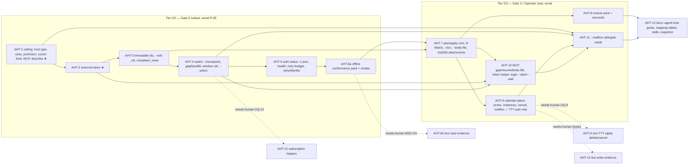

# Build Loop: agent-host integration (AH- / AHT-)

**Spec:** tasks/specs/agent-host-integration-spec.md (Step 1 + Step 2 done 2026-10-17, f1cc32c; Step 3 decisions E1–E8 below) · **Branch:** `build/agent-host-integration` (off `origin/main` 2be3fce)
**Previous harnesses:** tasks/archive/ (admin-oversight-run archived by this run).

## Resolved placeholders

| Placeholder | Value |
|---|---|
| `<TEST_CMD>` | `npm test` + `npm run typecheck` (+ `npm run docs:check` for tasks that add options/commands) |
| `<RUN_CMD>` / `<SMOKE_SCENARIO>` | `node dist/index.js` / `scripts/smoke.sh` (15 checks today) + AHT-6a host-mode checks, all offline: `type: host` profile ceiling refusal under `--dry-run` → exit 4, last stderr line `{"error":{"code":"scope_ceiling"}}`; `describe --json` lists `--refs`, `watch --checkpoint`/`--select`, `health`, `auth status -o`; `auth status -o json` with an env JWT → `source:"external"`, no MSAL load; `watch mail --checkpoint new` against a fetch-stub preload → last line `type:"checkpoint"`, no `watch/` dir. Signals = exit code + parsed JSON field. |
| `<FULL_SUITE_BUDGET>` | measured 6.5 s (`npm test`, 1784 tests) + 0.24 s tsc + 0.23 s docs:check → full gate after every task |
| `<RUN_BUDGET>` | unbounded |
| `<RELIABILITY>` | Fastest at 90 % (default option, not chosen by the user) |
| `<REVIEW_MODEL>` | invoking model (self-review, adversarial) — Step 1 was done by the spec reviewer |

**Baseline (2be3fce + spec commits, Node 24.21.0):** `npm test` 58 files / 1784 tests passed, 6.0 s (6.5 s wall); `tsc --noEmit` 0 errors (0.24 s); `docs:check` clean (0.23 s); `scripts/smoke.sh` pass=15 fail=0 skip=0 (6.1 s incl. `tsup` build). Known-failure list: empty.

## Dev-loop cost baseline
One change lands for ≈ 8 s of local CPU (suite + tsc + docs:check); smoke ≈ 6 s. No GPU, device or CI runner. The only scarce resources are (a) the live tenant + Chief's Entra app + the principal's time (needs-human, excluded: AHT-6b/AHT-14) and (b) this single agent's serial attention (R-35: G2 tasks share `index.ts`, `profiles.ts`, `commands/auth.ts`, `formatter.ts`, `watch.ts`). Spawned-entry tests (≈ 0.6 s each through tsx) are capped at 12 new for the AH subset.

## Plan options
| Option | Wall time | P(inside range) | P(real problem slips) | Slip cost |
|---|---|---|---|---|
| **Fastest @90 % (active)** | 7–11 h [INFERENCE] | ~70 % | ~10 % | found by Chief's MSC wrapper or the AHT-6b live run; ≈ 1–2 h to fix |
| Balanced | 8–12 h [INFERENCE] | ~70 % | ~5 % | as above, rarer |
| Most reliable | 9–14 h [INFERENCE] | ~65 % | ~2 % | as above, rare |
- Fastest: suite+tsc every task, docs:check on option changes, smoke once per tier, one implementation review at the end.
- Balanced: Fastest + an extra adversarial review after AHT-1/AHT-2 (critical path).
- Most reliable: smoke + docs:check every task, adversarial review per tier, fail-first re-proved for every AC.

## Task DAG


★ = critical path. Execution order (topological, spec priority G2 first): AHT-1 → 2 → 3 → 4 → 5 → 6a → 7 → 8 → 9 → 10 → 11 → 13. Self-check: 12 buildable nodes, every non-needs-human AHT item exactly once (AHT-6 split a/b, AHT-9 split TTY/non-TTY), acyclic (the order above is a valid topological sort).

## Track / contention graph
All tracks share implicitly: `src/catalog.ts`, `README.md` (generated), `test/__snapshots__/snapshot.test.ts.snap`, `tasks/*`. Per-task files: AHT-1 `index.ts, profiles.ts, catalog.ts, ceiling.ts(new), formatter.ts, mcp-server.ts, describe.ts`; AHT-2 `index.ts, profiles.ts, auth.ts, commands/auth.ts, errors.ts, graph-client.ts, external-token(new), child-env(new), grant-scopes.ts, keychain.ts, setup.ts`; AHT-3 `graph-client.ts, formatter.ts, mail.ts, calendar.ts, watch.ts, workflow.ts, refs(new)`; AHT-4 `watch.ts`; AHT-5 `commands/auth.ts, health(new), graph-client.ts, errors.ts`; AHT-7 `mail.ts, calendar.ts, plan(new), apply(new)`; AHT-8 `mail.ts, idempotency.ts`; AHT-9 `calendar.ts`; AHT-10 `mcp-server.ts, auth.ts, commands/auth.ts`; AHT-11 `mail.ts, calendar.ts, watch.ts`. No pair of ready tasks is disjoint once `catalog.ts`/README/snapshot are counted → **parallel dispatch loop disabled** (E4); one agent, serial.

## Loops
- **Outer:** take the next node in the order above whose dependencies are DONE and that is not needs-human; run the inner loop; mark DONE in `todo.md`; re-evaluate.
- **Inner (one task):** read the touched code → fail-first tests for each behaviour change (run only the task's test files) → implement → task tests green → orchestrator gate in a separate step: `npm test` + `npm run typecheck` (+ `docs:check`, `npm run docs` to regenerate when options changed) → self-review checklist: diff confined to the task's files; no TODO/dead code; no secret/real address/tenant id/token in any file (role refs only; test JWTs are synthetic); reuse existing helpers (`scopeSatisfied`, `tokenInfo`, `writeFileAtomic`, `printList`, `runCommand`, ledger) before new code; no speculative abstraction; matches the touched file's pattern; diff size proportional → commit with explicit paths (`git commit -m … -- <paths>`) → `chown -R cklaus:cklaus` the repo.
- **Meta:** on any correction/failure append mistake → rule to `tasks/lessons.md`; on divergence update the spec (`[REVISED: build …]`) and the divergence log below. A rule firing twice becomes a mechanism (script/guard test).
- **Full-suite regression:** after every task (the gate costs ≈ 8 s), compared with the 1784/1784 baseline. A new failure blocks unless it is on the known-failure list (empty) via the skill's tally + 3× re-run-through-gate procedure.
- **Smoke/integration:** once per tier (after AHT-6a and after AHT-13): `scripts/smoke.sh` (builds `dist/`, runs in a mktemp dir, 30 s per check), then `git status --short --ignored` must show nothing new beyond `dist/`, `node_modules/` and the owner's untracked files. MCP long-lived server behaviour (AHT-10) is covered in-process by `test/mcp.test.ts` with the injectable `Runner`.
- **Implementation review:** when every buildable node is DONE, one read-only adversarial reviewer against the finished code and ACs 1–32; each finding reproduced (fail-first test or observed output) before acting; dispositions recorded in the end-of-run report.
- **Dev-loop cost:** per tier, split agent time into implementing / gate-waiting / rework; the largest non-useful share gets an action or an `opportunities.md` entry with numbers.
- **Re-plan:** a task whose diff grows past ~2× its expected size, or whose 2nd attempt fails, is re-scoped in the spec before attempt 3.
- **Contract loop:** any change to the cross-spec contract (spec line 286) is sent to `agent://BuildMsc` with the exact change and recorded as `[REVISED: build …]`; changes received from BuildMsc are applied in the next task boundary.

## Gates
- **Critical path: AHT-1 (ceiling) and AHT-2 (external token source).** Everything Chief relies on sits on them (host profile, `scope_ceiling`, `token_*` codes; AHT-5 health `uses`, AHT-7 apply re-check, AHT-11 `.Shared` selector). Extra proof: (a) a property test over **every** catalog path × a family of ceilings: the check refuses iff some `uses` clause has no scope satisfied by the ceiling, and adding scopes to a ceiling never turns an allowed command into a refused one (monotonicity); (b) end-to-end through the real entry: refusal makes zero fetch calls with `MS365_CLI_PREFLIGHT=0`, an opaque token and `--dry-run`; (c) AHT-2: external mode never loads MSAL and leaves the config dir unchanged (file-list diff), and every refusal code makes zero fetch calls. A BLOCKED AHT-1 or AHT-2 halts the run.
- **Dry-run snapshot:** changes only in AHT-3 (immutable-id header) and wherever a task adds a request-shape change it names; never `-u` blindly — diff read first.
- **Dependency hygiene:** no new npm dependency (JWT decode, sha256, canonical JSON all from `node:crypto`/in-repo).
- **Gate cost budget:** suite ≤ 15 s (spec), smoke ≤ 60 s. Above 2× → review before re-running.
- **Statistical gates:** none in this spec (no sampling gate).
- **Skip unchanged inputs:** smoke skipped when the `dist/` sha256 equals the last green run's.
- **Poison-task ceiling:** attempts 1–2 diagnose/re-plan; attempt 3 fails → BLOCKED, dependents blocked, logged.
- **Resumability:** commits are the source of truth; `todo.md` is derived from `git log --grep '^AHT-'`.

## Stop condition
```
DONE = AHT-1..5, 6a, 7, 8, 9 (TTY part), 10, 11, 13 DONE or BLOCKED-and-logged
       AND npm test + typecheck: no new failures vs the 1784 baseline; docs:check clean
       AND every AH-* item addressed or tagged needs-human (AHT-6b, AHT-9 non-TTY/OQ-8, AHT-12/OQ-14, AHT-14)
       AND scripts/smoke.sh passes with 0 FAIL / 0 SKIP incl. the AHT-6a host-mode checks
       AND the implementation review ran, every disposition recorded
```

## Known-failure list
(empty)

## Divergence log
- AHT-3: the dry-run snapshot did not churn (it excludes `Headers:` lines), unlike the Gates note expecting immutable-id churn.
- AHT-4: the snapshot's `watch` optional-flags run became exit 2 (`--checkpoint` + `--name` conflict, by design); E10/E11 added.
- AHT-5: `health` ceiling clause `User.Read` only; out-of-ceiling resources in-band `UNSUPPORTED scope_ceiling` (E12; BuildMsc acked). Record value sources fixed (E13). `test/helpers/cli.ts` routes may now be async and see the abort signal.
- AHT-6a: smoke 15 → 32 checks (7.9 s); fail-first on the pre-AHT-5 dist: 10 FAIL. Conformance digest printed per run; the pinned digest is the one recorded at the end of the run.
- AHT-7: `payload` uses Graph field names, not Chief's schema (E15, schema not local). `--body-file` satisfies a mandatory `--body` through commander `implies`; the snapshot's optional-flags runs skip `--body-file`. `--if-match` also landed on `calendar update/delete` (AC20 names them; plan support for calendar stays AHT-9). Fail-first: `test/plan.test.ts` on 6c78b80 fails (no `apply` module).
- AHT-8: `mail send` goes through the draft path for every caller, not only agent hosts (one path; E18), so its ceiling `uses` gains `Mail.ReadWrite`. Outbox matches map to `NOT_FOUND_YET` with evidence (the three-state contract stays). `mail send/reply/forward` became plan-capable here (AH-5(1)); reply/forward plans bind the original without If-Match (E19). `describe --json` gained `plan` and `providerIdempotency`; `generate-skills` now reuses describe's builders. Fail-first: `test/send-outcome.test.ts` on 290415b: 9 of 11 fail.
- AHT-9: TTY part only (OQ-8 needs-human): `apply` asks for calendar delete/cancel and exits 7 without a TTY (E22). "Host plan" defined as external-token mode (E21). `calendar create` also became plan-capable (AH-5(1) lists it; not in the AHT-9 row). `apply` re-catalogued `delete` for the confirm() guard. Update now always GETs once (two old tests asserting "no read" were rewritten). Fail-first: `test/calendar-plans.test.ts` on 7aa90fc: 13 of 13 fail.
