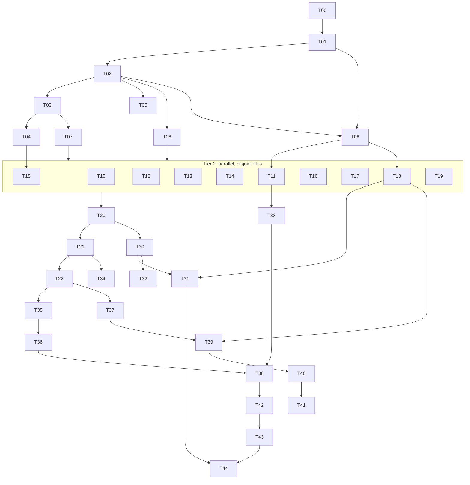

# Build Loop: ms365 findings spec

**Spec:** `docs/ms365-findings-spec.md` (after Step 1 review and Step 2 decisions D1–D25 and N1–N7) · **Branch:** `build/ms365-findings-spec`

## Resolved placeholders

| Placeholder | Value | How it was resolved |
|---|---|---|
| `<TEST_CMD>` | `npm test` (vitest), plus `npx tsc --noEmit` once T20 adds a typecheck | `package.json` |
| `<RUN_CMD>` | `node dist/index.js` (after `npm run build`) | `package.json` bin |
| `<SMOKE_SCENARIO>` | `scripts/smoke.sh`: 9 offline checks | No live tenant; refresh token expired 2026-09 |
| `<FULL_SUITE_BUDGET>` | ~2 s (measured: 1.72 s, 95 tests) | Small enough to run after **every** task |
| `<RUN_BUDGET>` | Unbounded | Compound stop condition plus the poison-task ceiling |
| `<REVIEW_MODEL>` | fable | Available here |
| `<MAX_SPEC_DRAFT_SUBAGENTS>` | 5 | Default |

**Smoke checks:**
1. `--version`
2. `schema --list` with no auth
3. dry-run mail send exits 0
4. dry-run 12 MB upload uses the session URL
5. an auth failure exits 3 and prints a hint
6. `--error-format json`
7. `describe --json`
8. MCP `tools/list`
9. a refused non-TTY confirmation exits 7

A check exits with **PASS**, **FAIL** or **SKIP** (feature not built yet).

## Baseline (Step 0, HEAD `88c5a64`/`d0651cc`)

- `npm test`: **5 files, 95 tests, all passing**. No flakes in 1 run.
- `npm run build`: success.
- `scripts/smoke.sh`: **pass=1, fail=6, skip=2**. Every failure maps to a spec item: C-1 (×4 via exit 143), M-25, PM-3.
- `npm audit`: 1 moderate (runtime), plus several high-severity advisories in dev dependencies.

## Task DAG

Each node lists the spec items it covers. **[CP]** marks a critical-path task (see Gates). Files are each task's write scope.

| ID | Tier | Task | Covers | Files (write scope) | Depends on |
|---|---|---|---|---|---|
| T00 | 0 | Dev toolchain upgrade: typescript, vitest, tsup, tsx, @types/node@22; `engines >=22.12`; CI matrix 22/24; README requirements and badge | G-11 (dev), D25, G-4 (engines/docs) | package.json, package-lock.json, .github/workflows/ci.yml, README.md, tsconfig.json, vitest.config.ts | — |
| T01 | 0 | Runtime dependency upgrade: dotenv 18, commander 15, @azure/msal-node 7.1.0 | G-11 (runtime), G-4, G-6, D8 | package.json, package-lock.json, src/index.ts (only if an API changed), src/auth.ts (only if an API changed) | T00 |
| T02 | 0 | **[CP]** Exit and error contract: `ExitCode` and `CliError`; `handleErrors` → `process.exit` after drain; `--error-format json`; map Graph status codes to exit codes; `confirm` refusal → 7; wrap `auth` commands; test hook so tests don't exit | C-1, P-3, PM-3, C-20, M-13, M-15, D1–D3 | src/errors.ts, src/utils.ts (confirm only), src/commands/auth.ts, src/index.ts (flag only), src/graph-client.ts (typed throws only), src/commands/mail.ts (batch exit only), test/errors.test.ts | T01 |
| T03 | 0 | **[CP]** GraphClient core: method-aware `fetchWithRetry`; `responseType` json/text/binary/stream; pagination through the shared path with headers and 401 refresh; keep `@odata.type`/`etag`/`count`; return metadata; manual redirect for `/content`; `requestRaw` | C-3, P-2 (core), C-7, C-8, C-9, G-2 (code), D4–D6, D15, D17 | src/graph-client.ts, test/graph-client.test.ts | T02 |
| T04 | 0 | Upload: session URL fix; chunk retry and resume via `nextExpectedRanges`; timeouts; dry-run prints the session URL | C-2, C-11 | src/graph-client.ts (upload section), test/upload.test.ts | T03 |
| T05 | 0 | Startup: argv flags parsed by commander (including `=` forms); validate `api-version`; skip auth for offline commands; lazy-load command modules; `schema [endpoint]` | C-15, C-16, P-7, M-25 | src/index.ts, src/commands/schema.ts, test/index.test.ts | T02 |
| T06 | 0 | Shared helpers: time-zone resolver (D9), natural-time parser (D22), `encodePath`, `odataQuote`, `kqlQuote`, `safeOutputPath` with `--force` (D12), and the rule that status lines use `info()` | M-24 (helpers), C-10 (helpers), D9, D12, D22 | src/utils.ts, test/utils.test.ts | T02 |
| T07 | 0 | Command test harness: register a module against a fake `GraphClient` that records requests; run one command and get `{calls, stdout, stderr, exitCode}` | §7 | test/helpers/cli.ts, test/helpers.test.ts | T02, T03 |
| T08 | 1 | **[CP]** Auth cache rework: `ICachePlugin` with lockfile and unique temp files; persist after a silent acquire when `fromCache===false`; selected account stored in a file only; full logout cleanup; keytar → optionalDependency used once for migration, with the probe memoised; `forceRefresh`; account selected after login; `null` login result; `Place.Read.All`, meeting scopes and Mail scopes added to scope lists | C-4, C-5, C-6, C-12, C-13, C-14, C-17, C-18, P-1, P-4, G-5 (D7), M-18 (scope) | src/auth.ts, package.json, .github/workflows/ci.yml, test/auth.test.ts, test/auth-cache.test.ts | T01, T02 |
| T10 | 2 | mail.ts fixes | M-1, M-3, M-11 (D11), M-17, M-19, M-24 (mail), M-30, M-31, C-19 (mail), G-1 | src/commands/mail.ts, test/commands/mail.test.ts | T03, T06, T07 |
| T11 | 2 | calendar.ts fixes | M-9, M-18, M-23, M-26 (cal), M-29 (attendees), M-10 (cal) | src/commands/calendar.ts, test/commands/calendar.test.ts | T03, T06, T07, T08 |
| T12 | 2 | workflow.ts fixes | M-7, M-8, M-16, M-21, M-22, M-10 (`workflow.ts:244`), C-19 (workflow) | src/commands/workflow.ts, test/commands/workflow.test.ts | T03, T06, T07 |
| T13 | 2 | excel.ts fixes | M-4, M-5, M-24 (excel) | src/commands/excel.ts, test/commands/excel.test.ts | T03, T06, T07 |
| T14 | 2 | teams.ts fixes | M-6 (D10), M-26 (teams) | src/commands/teams.ts, test/commands/teams.test.ts | T03, T06, T07 |
| T15 | 2 | drive.ts fixes and streamed downloads | C-10 (drive), C-19 (drive), M-20, M-29 (password), P-2 (callers) | src/commands/drive.ts, test/commands/drive.test.ts | T04, T06, T07 |
| T16 | 2 | todo.ts and planner.ts fixes | M-10 (todo/planner), M-14, M-27, G-9 | src/commands/todo.ts, src/commands/planner.ts, test/commands/planner-todo.test.ts | T03, T06, T07 |
| T17 | 2 | user.ts fixes | M-10 (set-ooo), M-28 (photo), M-26 (user) | src/commands/user.ts, test/commands/user.test.ts | T03, T06, T07 |
| T18 | 2 | Setup wizard, `auth` command, generate-skills | M-2 (D13), M-12 (D14), M-28 (status, setup, Windows, skills), C-16 (setup) | src/commands/setup.ts, src/commands/auth.ts, src/commands/generate-skills.ts, src/auth.ts (`buildScopes` reads config), test/commands/setup.test.ts | T08, T07 |
| T19 | 2 | sharepoint, groups, contacts, onenote, search fixes | C-10 (sp), M-26 (groups/contacts) | src/commands/sharepoint.ts, groups.ts, contacts.ts, onenote.ts, search.ts, test/commands/misc.test.ts | T03, T06, T07 |
| T20 | 2 | CI typecheck (`tsc --noEmit`) and a dry-run endpoint snapshot for every command | §7 | .github/workflows/ci.yml, package.json (scripts), test/snapshot.test.ts, test/__snapshots__ | T10–T19 |
| T21 | 3 | Streaming `--all`; `-o ndjson`; `--fields`; `--cursor` | P-6, D18, §6 (pagination/fields), PM-10 (`--fields`) | src/formatter.ts, src/utils.ts, src/graph-client.ts (cursor), the list commands in src/commands/*.ts | T20 |
| T22 | 3 | `$batch` helper; `batch-read` and `batch-move` use it | P-5, G-10, D19 | src/graph-client.ts, src/commands/mail.ts | T21 |
| T30 | 4 | `describe --json` catalogue (args, options, destructive, idempotent, scopes) | §6 discover | src/commands/describe.ts, src/catalog.ts, src/index.ts | T20 |
| T31 | 4 | Generate the README command table and SKILL.md from the catalogue; CI drift check | PM-11, M-28 (skills text) | src/commands/generate-skills.ts, scripts/gen-docs.ts, README.md, ci.yml | T30, T18 |
| T32 | 4 | `mcp serve` (stdio JSON-RPC that spawns the CLI per call) | §6 one protocol, D16 | src/commands/mcp.ts, src/index.ts | T30 |
| T33 | 4 | `meetings` group; `cal create --teams`; `cal find-time` | PM-4, G-7 | src/commands/meetings.ts, src/commands/calendar.ts, src/index.ts | T11, T08 |
| T34 | 4 | `watch` (delta with a saved cursor, NDJSON output) | PM-5, P-8 | src/commands/watch.ts, src/index.ts | T21 |
| T35 | 4 | `mail send/draft/reply --attach` | PM-6 | src/commands/mail.ts | T22 |
| T36 | 4 | `--body text\|markdown\|none`, `--max-chars`, untrusted-content marking | §6 token budget and untrusted content | src/commands/mail.ts, src/commands/teams.ts, src/utils.ts | T35 |
| T37 | 4 | Audit log for non-GET calls, `audit tail`, `--actor` | §6 accountability | src/audit.ts, src/graph-client.ts, src/commands/audit.ts, src/index.ts | T22 |
| T38 | 4 | `--idempotency-key` (D23) | §6 retries | src/idempotency.ts, src/commands/mail.ts, src/commands/calendar.ts | T36, T33 |
| T39 | 4 | `auth scopes`; pre-flight `missing_scope` error | §6 consent introspection | src/commands/auth.ts, src/auth.ts, src/graph-client.ts | T37, T18 |
| T40 | 4 | `--account` and `--profile` (D21) | PM-8 | src/index.ts, src/auth.ts | T39 |
| T41 | 4 | `auth login --browser` (PKCE loopback) | PM-2 (interactive part) | src/auth.ts, src/commands/auth.ts | T40 |
| T42 | 4 | Name resolution: `resolve` command; names accepted for todo lists, team/channel and planner plan | §6 names not IDs | src/resolve.ts, src/commands/resolve.ts, todo.ts, teams.ts, planner.ts | T38, T16, T14 |
| T43 | 4 | Coverage gaps: excel tables and rows, todo checklist, teams chat create and @mentions, Outlook notes, multi-entity search | PM-9, G-8 | excel.ts, todo.ts, teams.ts, src/commands/notes.ts, search.ts | T42 |
| T44 | 4 | Shell completion and default table columns | PM-10 | src/commands/completion.ts, src/formatter.ts | T43, T31 |

**No-op or addressed-by-decision items:** G-3 (no usage; grep confirmed), D20 `--wait` (false positive), the §6 envelope (N5), and §6 policy/plan-apply (N3).

**Excluded as `needs-human`:** N1–N7. The excluded subtree covers 7 spec items: PM-1, PM-2 (app-only), PM-7 and the §6 safety rows, PM-12, the §6 envelope, encryption at rest, and live-tenant validation.

### DAG



**Track (contention) graph.** These files are touched by more than one task, so those tasks are serialised:
- `graph-client.ts`: T02 → T03 → T04 → T21 → T22 → T37 → T39
- `mail.ts`: T02 → T10 → T22 → T35 → T36 → T38
- `auth.ts`: T01 → T08 → T18 → T39 → T40 → T41
- `index.ts`: T02 → T05 → T30 → T32 → T33 → T34 → T37 → T40
- `calendar.ts`: T11 → T33 → T38
- `utils.ts`: T02 → T06 → T21 → T36
- `teams.ts`: T14 → T36 → T42 → T43
- `todo.ts`/`planner.ts`: T16 → T42 → T43

Tier 2 is the only wide fan-out (T10–T17 and T19 are pairwise disjoint). T18 waits for T08.

## Loops

**Outer loop.**
- **Trigger:** after the flight plan; again after each task completes.
- **One iteration:**
  1. Compute the ready set: dependencies DONE, not blocked, not `needs-human`.
  2. Pick by tier, then by ID.
  3. Run the inner loop.
  4. Mark the task DONE in `todo.md`.
  5. Re-evaluate readiness.
- **Exit:** the ready set is empty → run the stop-condition check.

**Inner loop (one task).**
1. Read the spec rows the task covers.
2. For a behaviour change, write the regression test first and confirm it **fails**.
3. Implement.
4. Run `npm test` (the full suite, which is cheap) and `npm run build`.
5. Self-review against this checklist:
   - Diff stays inside the task's write scope.
   - No new TODOs or dead code.
   - No secret values written anywhere.
   - Existing helpers and dependencies reused before writing new ones.
   - No speculative abstraction.
   - Matches the file's existing patterns.
   - Diff size is proportionate to the task.
6. Commit as `T<id>: <summary>` with spec IDs in the body.

**Parallel dispatch loop (Tier 2 only).**
- **Trigger:** T02, T03, T06 and T07 are done.
- **One iteration:**
  1. Dispatch subagents for the pairwise-disjoint tasks T10, T12, T13, T14, T16, T17, T19, plus T15 once T04 is done, and T11 and T18 once T08 is done.
  2. Each subagent edits only its own write scope and doesn't commit, so agents never race on the git index.
  3. The orchestrator then reviews each diff, runs the full suite and commits each task separately.
- **Exit:** no ready pair has disjoint scopes; dispatch falls back to sequential.

**Meta loop.**
- **Trigger:** a correction, a failure, or reality diverging from the plan.
- **Action:** append a mistake → rule entry to `tasks/lessons.md`, and update the spec or DAG.

**Full-suite regression loop.**
- **When:** after every task (the suite takes ~2 s), and with `tsc --noEmit` from T20 onward.
- **Pass:** no new failures compared with the baseline of 95/95.

**Smoke loop.**
- **When:** at the end of each tier.
- **Action:** run `scripts/smoke.sh` (30 s per check; a hang counts as FAIL).
- **Pass (tier):** no FAIL among checks whose feature has shipped.
- **Pass (final):** pass=9, fail=0, skip=0.

**Re-plan loop.**
- **Trigger:** a dependency upgrade (T00/T01) forces API changes.
- **Action:** record the change in lessons and adjust the scopes of later tasks before continuing.

## Gates

**Verification bar.**
- **Behaviour change:** the test fails before the fix and passes after it.
- **Behaviour-preserving** (T00, T01, T05 lazy-load): the gate is a clean full suite plus build plus smoke parity.

**Critical path and its extra gates.**
- **T02 (exit and error contract):** a matrix test that spawns the built CLI and checks exit codes 0, 1, 2, 3, 5 and 7. Everything imports `handleErrors`.
- **T03 (GraphClient core):** an invariant test that round-trips the bytes of 8 MIME types byte-for-byte, plus proof that a POST is never retried after a timeout and a GET is. Every command goes through `request()`.
- **T08 (auth cache):** a round-trip test (serialize → persist → load gives an identical cache) plus a concurrency test where 8 parallel processes write and the cache file stays valid JSON.

**Transitive blocking.** A blocked task blocks every task that depends on it. A blocked **[CP]** task stops the run immediately.

**Poison-task ceiling.** Attempts 1–2: diagnose and retry. A third failure parks the task as BLOCKED and its dependents as blocked.

**Dependency hygiene.**
- No new third-party dependencies outside T00/T01 (version bumps only). D16, D22 and D7 are hand-rolled.
- keytar moves to `optionalDependencies`.

**Resumability.**
- Commits are the truth: `git log --grep '^T[0-9]'` rebuilds DONE status.
- The flight plan is regenerated only if the DAG changes.

**Harness self-check.** The DAG must be acyclic (checked by topological sort) and must cover every non-needs-human spec ID exactly once.

## Stop condition

```
DONE = every non-needs-human node is DONE or BLOCKED-and-logged
       AND npm test + tsc --noEmit show no new failures vs. baseline (95 passing)
       AND every spec ID is addressed, a documented no-op, or tagged N1–N7
       AND scripts/smoke.sh → pass=9 fail=0 skip=0
```

## Lifecycle of a task

```
READY → IN_PROGRESS → (test fails first) → IMPLEMENTED → VERIFIED (suite+build) → REVIEWED → DONE(commit)
                 ↘ attempt failed ×1–2 → re-plan → IN_PROGRESS
                 ↘ attempt failed ×3 → BLOCKED (dependents blocked; [CP] → HALT)
```

**Split items.** Some spec IDs are split by file. Each part is owned by exactly one task, and the label says which part:
- G-11 and G-4: dev in T00, runtime in T01
- P-2: core in T03, callers in T15
- C-10, M-24, M-26, M-10, C-19 and M-29: per command file
- C-16: index in T05, setup in T18
- M-18: scope in T08, endpoint in T11
- M-28: per command
- PM-10: `--fields` in T21, completions in T44
