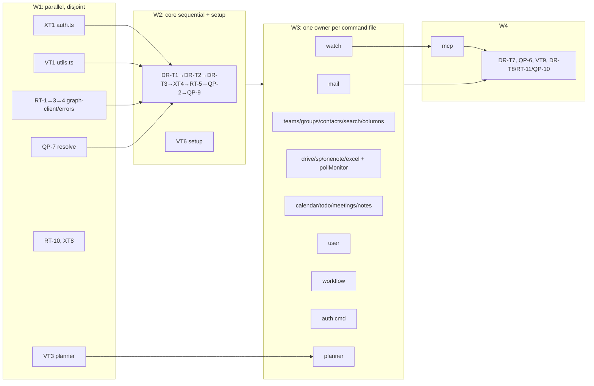

# Build Loop: follow-up specs (5 specs, one run)

**Specs:**
- tasks/specs/dry-run-fidelity-spec.md (DR)
- tasks/specs/query-pagination-spec.md (Q)
- tasks/specs/robustness-spec.md (R)
- tasks/specs/validation-consistency-spec.md (V)
- tasks/specs/performance-dx-spec.md (X)

**Decisions:** tasks/specs/DECISIONS.md (F1–F30; needs-human N1–N3). **Branch:** `build/followup-specs`. The previous run's harness is in tasks/archive/findings-spec-run/.

## Resolved placeholders

| Placeholder | Value |
|---|---|
| `<TEST_CMD>` | `npm test` + `npm run typecheck` |
| `<RUN_CMD>` | `node dist/index.js` |
| `<SMOKE_SCENARIO>` | `scripts/smoke.sh`, 9 offline checks, plus 3 checks added in FIN (see below) |
| `<FULL_SUITE_BUDGET>` | ~4.5 s (measured: 854 tests in 4.43 s), so the full suite runs after every task |
| `<RUN_BUDGET>` | unbounded |
| `<REVIEW_MODEL>` | fable |

The 3 smoke checks FIN adds:
- a dry-run with no client ID exits 0
- the dry-run trace goes to stderr
- a redacted password never appears in the output

**Baseline (Step 0, HEAD b8b58d9):**
- tests: 854/854 passing
- typecheck: 0 errors
- smoke: pass=9 fail=0 skip=0
- docs:check: clean
- npm audit: 0

## Tasks: the spec task IDs, grouped into waves by file ownership

Each spec's own task table (in its "Suggested task breakdown") defines what a task covers; this harness only schedules them.

**Folded or excluded tasks:**
- XT2 → DR-T2; XT3 → DR-T1; VT8 → DR-T2's test (each folded, per the reviews and F30)
- XT10, XT11 → needs-human N1
- the X-12 part of XT8 → N2

| Wave | Track (owner agent) | Tasks, in order | Write scope (exclusive during the wave) |
|---|---|---|---|
| W1 | A1 auth-lazy | XT1 | src/auth.ts, test/auth*.test.ts, test/index.test.ts |
| W1 | A2 utils | VT1 | src/utils.ts, test/utils*.test.ts |
| W1 | A3 graph-client | RT-1 → RT-3 → RT-4 | src/graph-client.ts, src/errors.ts, test/upload.test.ts, test/graph-client*.test.ts, test/errors.test.ts |
| W1 | A4 resolve | QP-7 | src/resolve.ts, src/commands/resolve.ts, test/resolve.test.ts |
| W1 | A5 audit+completion | RT-10, XT8 (X-10, X-11) | src/audit.ts, src/commands/completion.ts, test/audit.test.ts, test/completion.test.ts |
| W1 | A6 planner | VT3 | src/commands/planner.ts, test/commands/planner-todo.test.ts |
| W2 | C core (sequential, one agent) | DR-T1 → DR-T2 → DR-T3 → XT4 (timings only) → RT-5 (adds `idempotentSend` to idempotency.ts, F19) → QP-2 → QP-9 | graph-client.ts, auth.ts, index.ts, utils.ts, errors.ts, formatter.ts, test/helpers/cli.ts, commands/auth.ts, idempotency.ts, commands/idempotency.ts, catalog.ts, preflight.ts, describe.ts, docs-gen.ts, every `printList` caller (QP-2 touches all command files, so nothing else runs during W2) |
| W2 | C2 setup (parallel with C; disjoint) | VT6 | src/commands/setup.ts, test/commands/setup.test.ts |
| W3 | B1 mail | RT-2 → RT-6 → RT-8 → QP-8 (mail part) → the mail parts of QP-5, DR-T4, DR-T5 (mail.ts:395), DR-T6 (download-attachment) and VT7 (V-18 mail:604, V-19) → RT-7 (shared-send) | src/commands/mail.ts, test/commands/mail*.test.ts |
| W3 | B2 watch | QP-8 (watch part, Q-13) → DR-T6 (DR-18) → RT-9 → XT5 (cursorName part) | src/commands/watch.ts, test/commands/watch.test.ts |
| W3 | B3 teams/groups/contacts/search/columns | QP-1 → QP-3 → VT4 (teams part) → DR-T4 (teams/contacts/groups parts) → RT-7 (Teams part) → XT9 | teams.ts, groups.ts, contacts.ts, search.ts, src/columns.ts, their tests |
| W3 | B4 drive/sharepoint/onenote/excel | QP-4 → DR-T4 (drive/excel parts) → VT7 (drive/excel parts) → XT5 (drive `readStdin` guard) → XT6 (`pollMonitor` in graph-client + `drive copy`) | drive.ts, sharepoint.ts, onenote.ts, excel.ts, their tests; graph-client.ts **only** for `pollMonitor` (no other W3 track touches graph-client) |
| W3 | B5 calendar/todo/meetings/notes | QP-5 (calendar, todo, meetings parts) → VT4 (calendar part) → DR-T6 (calendar zone marker) → DR-T4 (calendar/todo/notes/meetings parts) → VT7 (todo/calendar parts) | calendar.ts, todo.ts, meetings.ts, notes.ts, their tests |
| W3 | B6 user | VT2 → DR-T6 (presence) → DR-T4 (user part) | user.ts, test/commands/user.test.ts |
| W3 | B7 workflow | DR-T5 → VT7 (workflow parts) → DR-T4 (workflow part) | workflow.ts, test/commands/workflow.test.ts |
| W3 | B8 auth cmd | VT5 | commands/auth.ts, src/auth.ts (accounts only), test/auth-features.test.ts |
| W3 | B9 planner | QP-5 (planner Premium wrapper) → DR-T4 (planner part) | planner.ts, test/commands/planner-todo.test.ts |
| W4 | B10 mcp (after B2) | XT5 (mcp-server part: hide `--max-failures`/`--follow`/`--interval`, `passwordStdin`, MCP env marker) → XT7 | mcp-server.ts, commands/mcp.ts, test/mcp.test.ts |
| W4 | FIN (orchestrator) | DR-T7 → QP-6 → VT9 → DR-T8 / RT-11 / QP-10: one snapshot regeneration, catalog entries for new commands (`drive copy`, `idempotency list/release`), describe MODULES, `npm run docs`, smoke additions | test/__snapshots__, test/snapshot.test.ts, new guard tests, catalog.ts, test/describe.test.ts, README.md, scripts/smoke.sh |

### Track (contention) graph



**Why the waves:**
- W2 is serial because QP-2 touches every command file and DR-T1–T3 change shared infrastructure (graph-client, utils, errors, index) that every W3 task builds on.
- W3 tracks are pairwise disjoint by file. Within a track, items run in the listed order.

### Dependency notes (from the specs' Depends-on columns)

- XT1 → DR-T2 (auth.ts)
- DR-T1 → DR-T3 (counter)
- VT1 → DR-T3 (`confirm()`)
- RT-4 → RT-5
- QP-7 → QP-8 and QP-9
- QP-2 → QP-1, QP-3, QP-4, QP-5
- QP-7 → QP-5 (drafts literal)
- RT-1 → RT-2 → RT-8
- RT-5 → RT-7
- DR-T3 → DR-T4
- QP-8 → RT-9 and XT5
- DR-T6 → XT7
- everything → DR-T7 → DR-T8

All of these are satisfied by wave order.

## Loops

**Outer loop.**
- **One iteration:** run the next wave.
- **Within a wave:** dispatch tracks as parallel subagents. Each owns its write scope exclusively and doesn't commit.
- **After each track returns:**
  1. Review the diff for scope and size.
  2. Run the gate (full suite + typecheck).
  3. Commit.
- **Commits:** one per spec task where the files allow. When a track's tasks share files, one commit lists every task ID it covers. That's a declared deviation from per-task commits.

**Inner loop (per agent, per task):**
1. Write the regression test first and confirm it fails.
2. Implement.
3. Run your own tests and typecheck your files.
4. Self-review against the checklist: scope, no TODOs, no secret values, reuse before writing new code, no speculative abstraction, existing patterns, proportionate diff.

**Meta loop.** Lessons go in tasks/lessons.md (correction → rule). Divergences go in the log at the end of this file.

**Full-suite gate.**
- **Runs:** after every merged track. The orchestrator always runs it in a separate step from the commit (lesson 7).
- **Pass:** no new failures against the 854 baseline. Snapshot and describe-guard failures are expected until FIN only when the change is listed in the track's report.

**Smoke loop.** `scripts/smoke.sh` after W1, W2 and W3, and in FIN.
- **Pass (W1–W3):** no regression from 9/0/0.
- **Pass (FIN):** 12/0/0 with the new checks.

**Re-plan loop.** If a track hits a cross-file need outside its scope, it reports it instead of editing. The orchestrator either applies it between waves or adds it to FIN.

## Gates

**Critical path:**
- **DR-T1 + DR-T2 (graph-client preview path and lazy auth).** Every command's dry-run behaviour depends on them. Extra gate: a matrix test runs every command family under dry-run with no client ID and asserts:
  - exit 0
  - trace on stderr
  - stdout parseable for `-o json`
  - no credential value in either stream
- **RT-1 (shared uploader).** Extra gate: byte-exact round trips with resume, for drive and mail.
- **RT-5 (ledger).** Extra gate: concurrent claim stress (8 processes), plus pid-death detection.

**Blocking and failure handling:**
- **Transitive blocking:** a blocked task blocks everything that depends on it, and a blocked critical-path task halts the run.
- **Poison ceiling:** 2 retries, then park the task as BLOCKED.

**Dependency hygiene:** no new dependencies.

**Harness self-check:** the DAG must be acyclic, and every spec item must belong to exactly one scheduled spec task, a fold, or N1/N2/N3 (scripted check below).

## Stop condition

```
DONE = all scheduled tasks DONE or BLOCKED-and-logged
       AND npm test + typecheck: no new failures vs 854-baseline
       AND every DR/Q/R/V/X item addressed, folded (F30), or N1–N3
       AND scripts/smoke.sh pass=12 fail=0 skip=0 AND docs:check clean
```

## Divergence log
