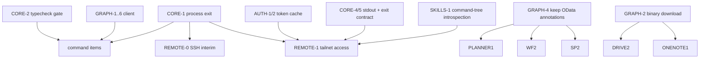

# ms365-cli — Review & Hardening Spec

Status: DRAFT (review output, not yet adversarially reviewed). Date: 2026-10-06.
Scope: everything under `src/`, `test/`, `README.md`, `package.json`. Consumable by `/build-loop tasks/ms365-cli-hardening-spec.md`.

## 0. Baseline (observed)

| Check | Result |
|---|---|
| `npx vitest run` | 5 files, 95 tests pass (no command-level tests exist) |
| `npx tsc --noEmit` | **756 errors**, all in `src/commands/*` — never run by `build` (tsup does not typecheck) or `test` |
| Built binary exit code | **143 on success and on failure** (`node dist/index.js mail list` not logged in → 143; `--dry-run calendar list` → 143) |
| Headless Linux `saveTokenCache()` | fallback file **not written**, process dies with unhandled `Cannot autolaunch D-Bus without X11 $DISPLAY` |
| `npm audit --omit=dev` | 2 moderate (`uuid` via `@azure/msal-node@2.16.3`); fix requires msal-node major bump |
| Git | no commits on `master`; everything untracked except staged `src/auth.ts`, `src/index.ts` |

Smoke entry point: `npm run build && node dist/index.js <cmd>`; offline smoke via `--dry-run` + `MS365_CLI_TOKEN=x`.

Priority: **P0** data loss / security / wrong-target or duplicate writes / unusable on a whole platform. **P1** documented feature broken. **P2** wrong edge behavior / UX / scripting contract. **P3** cleanup, docs.
Confidence tags: `[verified]` reproduced locally; `[code]` read from source, unambiguous; `[graph-doc]` depends on Graph API semantics — confirm against docs or a live tenant before fixing.

## 1. Critical path

Every command sits on four shared modules. These land first; command-level items depend on them.



Critical-path extra gate: CORE-1 and AUTH-1/2 need an end-to-end process test (spawn the built binary, assert exit code / file on disk), not only unit tests.

---

## 2. Core runtime

### CORE-1 (P0) Process always exits 143; failures indistinguishable from success `[verified]`
- `src/errors.ts:26` `setTimeout(() => process.kill(process.pid, 'SIGTERM'), 200)` overrides the `process.exitCode` set on lines 16/20. Under plain `node` the shell sees 143 for every command. (Under `tsx` the parent masks this, which is why it went unnoticed.)
- The 200 ms kill also races stdout flushing on platforms where pipe writes are async (macOS) `[graph-doc: Node stream semantics]`.
- The comment's premise ("tsx and Commander override process.exit") is wrong for Commander (exit override is opt-in). The real reason the loop stays alive is pending keytar promises left behind by `withTimeout` (`src/auth.ts:13-23`) and MSAL handles.
- `src/index.ts:13-18` monkeypatches `stdout.write` to call `_handle.flush()` — no such method; dead code.
- **Fix:** handleErrors awaits the action, then drains stdout/stderr (`write('', cb)`), closes logger, then `process.exit(code)`. Delete the SIGTERM and the write monkeypatch. Fix AUTH-1 so no keytar promise is orphaned.
- **Accept:** built binary: dry-run success → 0; not-logged-in → 1; usage error → 1; `ms365 --dry-run … -o json | wc -c` with ≥1 MB output is complete; `| head -1` still exits cleanly (EPIPE handler kept).

### CORE-2 (P1) 756 type errors; typecheck not gated `[verified]`
- Root cause: `handleErrors<T extends (...args: never[]) => Promise<void>>` (`src/errors.ts:12`) → every untyped `opts` parameter infers `never`. The noise hid real bugs (TEAMS-1 `info` not imported is TS2304).
- **Fix:** `handleErrors<A extends unknown[]>(fn: (...args: A) => Promise<void>): (...args: A) => Promise<void>`; give each action an options interface; add `"typecheck": "tsc --noEmit"` and run it in `test` (or a `check` script) so the gate fails on new errors.
- **Accept:** `tsc --noEmit` = 0 errors; `npm test` fails if a type error is introduced.

### CORE-3 (P1) preAction hook inspects the root command; `auth` skip never fires `[verified]`
- `src/index.ts:123` uses `thisCommand`; Commander passes `(hookedCommand, actionCommand)` and the hook is on `program`, so the chain is always `['ms365']`. Effects: `schema`, `generate-skills`, `auth setup` all require a client ID; log line always `Running: ms365 `; auth commands initialize twice.
- **Fix:** walk the second argument; skip auth init for `auth`, `schema`, `generate-skills`, `setup`.
- **Accept:** with no `MS365_CLI_CLIENT_ID`, `ms365 schema mail.list` and `ms365 generate-skills …` succeed.

### CORE-4 (P2) stdout must carry data only
- Dry-run prints `[dry-run] …` to stdout (`src/graph-client.ts:62-67,284-285`) ahead of the JSON body → `--dry-run -o json | jq` breaks.
- Empty-state text to stdout before format check: `mail triage` (“No messages found.”), `workflow meeting-prep`; status via `console.log` in `mail categorize`, `mail shared-send`, batch-read/batch-move summaries.
- **Fix:** all non-data text through `info()` (stderr, respects `--quiet`); empty results render through `formatOutput` (`[]` / `{value: []}`).
- **Accept:** for every command touched, `-o json` stdout parses with `JSON.parse`.

### CORE-5 (P2) Non-zero exit for "nothing happened" paths
- `confirm()` refusal returns normally → exit 0 (`calendar.ts:153`, `todo.ts:114`, `contacts.ts:119`, all other deletes).
- `mail batch-read`/`batch-move` exit 0 when items fail (`mail.ts:879-882,906-909`), print only truncated IDs, drop error text.
- `auth status` exits 0 when not logged in; `verifyLogin` swallows network errors as "not logged in" (`auth.ts:340-360`).
- **Fix:** refusal → exit 1 with a distinct message; batch → exit 1 if any failed, full IDs + error per failure; auth status → exit 1, distinguish network error.

---

## 3. Auth

### AUTH-1 (P0) Headless Linux: login never persisted and crashes `[verified]`
- `withTimeout` (`auth.ts:13-14`) returns `null` immediately when headless, but the argument `keytar.setPassword(...)` has already been called; its rejection is unhandled → process crash. `saveTokenCache` only falls back to the file inside `catch` (`auth.ts:164-170`), which never runs → no cache file. Same for `saveSelectedAccount` (`auth.ts:203-209`). Same when keytar times out after 2 s on a desktop.
- Directly blocks running the CLI on servers / tailnet hosts (see REMOTE-1).

### AUTH-2 (P1) Token cache lifecycle is wrong
- Refreshed tokens never persisted: `doTokenRefresh` (`auth.ts:241`) calls `acquireTokenSilent` but never `saveTokenCache` → every process after the first hour spends a network round trip on refresh, and rotated refresh tokens are discarded.
- Load prefers file (`auth.ts:138`, `178`), save prefers keytar → once a file exists, later keytar writes are ignored on load (stale cache forever).
- Fixed tmp name `token-cache.json.tmp` → concurrent processes (multiple agents) race on write/rename; second `renameSync` throws ENOENT.
- `device-code.txt` left in `~/.config/ms365-cli` after login (`auth.ts:271`).
- **Fix (decided, Q5):** file-only cache, no keychain. Remove `keytar` and `withTimeout` entirely (this also resolves AUTH-1). Implement an MSAL `ICachePlugin` over `~/.config/ms365-cli/token-cache.json`: `beforeCacheAccess` reads the file, `afterCacheAccess` writes it when `cacheHasChanged`. Write to a unique tmp file (`token-cache.json.<pid>.<rand>`) with mode 0600, then rename. On every start, force the directory to 0700 and the file to 0600 (`chmod`), even if they already exist. `selected-account.json` follows the same rules. Delete `device-code.txt` once login completes.
- Concurrency: last writer wins. A concurrent login on two machines that share a cache can drop one newly added account — acceptable, and moot under REMOTE-1 (one host). No lockfile.
- Migration: tokens stored only in the OS keychain are not migrated; affected users run `ms365 auth login` once (changelog entry). Users who already used the file fallback keep the same path.
- **Accept:** headless `auth login` (fake MSAL) writes the cache file at 0600 inside a 0700 dir, exit 0; 10 concurrent processes that refresh leave a cache that parses; a silent refresh persists the cache (content changes); `grep -r keytar src package.json` → empty.

### AUTH-3 (P1) Scopes don't cover implemented commands `[graph-doc]`
- No `MailboxSettings.*` anywhere (`auth.ts:43-72`) → `mail rules/rule/create-rule/update-rule`, `user mailbox-settings`, `user set-ooo`/`get-ooo` get 403.
- Setup wizard's `PERMISSION_GROUPS` (`setup.ts:165-169`) diverges from `buildScopes()` (no Presence, no `Group.Read.All`, no `Calendars.Read.Shared`) and the chosen set is never persisted → silent acquisition later asks for unconsented scopes.
- `cal rooms` needs `Place.Read.All` if moved to `/places` (CAL-1).
- **Fix:** single scope table keyed by command group; setup derives from it; add `MailboxSettings.ReadWrite`.

### AUTH-4 (P1) Setup wizard can't bootstrap `[code]`
- `setup.ts:60-64` calls `getAuth()` before asking for a client ID → throws "run: ms365 auth setup" (circular). Option "[1] built-in app registration" has no built-in client ID. "Use existing login?" answer ignored (`setup.ts:66-73`). Windows `start "url"` opens a blank console (`setup.ts:116-118`).
- **Decided (Q2):** with no `MS365_CLI_CLIENT_ID`, default to the Microsoft Graph Command Line Tools public client ID (`14d82eec-204b-4c2f-b7e8-296a70dab67e` — check against Microsoft docs before shipping). Option [1] uses it with no app registration. `MS365_CLI_CLIENT_ID` still overrides it.
- Risks to cover: tenants can block or require admin consent for this app → on `AADSTS65001`/`AADSTS50105`/`AADSTS700016`-class errors, print a message pointing to the custom-app path (option [2]). [INFERENCE] Personal Microsoft accounts may not be supported for this app; test MSA login and, if it fails, say so in the setup text and README.
- Also fix: construct `AuthManager` only after a client ID is resolved; honor "Use existing login?"; on Windows run `start "" "<url>"`.
- **Accept:** fresh `HOME`, no env → `ms365 auth setup` reaches the device-code prompt with no throw; `MS365_CLI_CLIENT_ID=x` → the custom ID is used (asserted via MSAL config in a unit test).

---

## 4. GraphClient (`src/graph-client.ts`)

### GRAPH-1 (P0) Non-idempotent requests retried → duplicate sends `[code]`
- Loop at `:83` retries any method on timeout (`AbortError`) and on 5xx (`:124-131`). A `POST /me/sendMail`, chat message, event create that times out after the server accepted it is sent again.
- **Fix:** retry timeout/5xx only for GET/HEAD/PUT/DELETE; POST/PATCH retry only on 429 (request rejected before processing). Surface "request may have been applied" on POST timeout.
- **Accept:** unit test with mocked fetch: POST + 503 → 1 call; GET + 503 → 3 calls; POST + 429 → retried.

### GRAPH-2 (P1) Binary downloads corrupted / `--out` ignored `[code]`
- Binary detection only for `audio/ video/ image/ application/octet-stream` (`:174-177`). PDF/DOCX/ZIP/text/JSON go through `response.text()`/`JSON.parse`; `drive download`, `download-shared`, `cat` then print `{rawResponse}` and never write `--out` (`drive.ts:70-79,127-137,295-309`), exit 0. JSON files get `@odata.*` stripped.
- Whole file base64'd into memory.
- **Fix:** `requestBinary(endpoint): Promise<ReadableStream|Buffer>` that never parses; commands stream to file via one shared `saveOrStream(out)` helper; honours dry-run/retry.
- **Accept:** mocked `application/pdf` body round-trips byte-identical to `--out`.

### GRAPH-3 (P1) Upload: >4 MB always fails; silent overwrite `[code]`
- Callers pass `…:/name:/content` (`drive.ts:101,325`); session URL becomes `…:/content/createUploadSession` (`:324`) — Graph expects `…:/name:/createUploadSession`.
- `conflictBehavior: 'replace'` hard-coded (`:332`); simple PUT also replaces. No timeout/retry on PUTs/chunks; failed session not cancelled. `user upload-photo` >4 MB would hit the session path on `/me/photo/$value`.
- **Fix:** `uploadFile(itemPath)` appends `:/content` or `:/createUploadSession` itself. Conflict handling decided (Q4): `--conflict rename|replace|fail`, **default `rename`**. Simple PUT sends `?@microsoft.graph.conflictBehavior=<v>`; sessions send `item['@microsoft.graph.conflictBehavior']`. Output and `info()` report the **name Graph actually stored** (e.g. `report (1).docx`), so agents see the rename. Chunk retry via `nextExpectedRanges`; photo upload rejects >4 MB.
- **Accept:** mocked fetch: default upload URL carries `conflictBehavior=rename`; a returned name that differs from the requested one shows up in the stderr notice and the JSON output; >4 MB session URL ends `:/createUploadSession`.

### GRAPH-4 (P1) All `@odata.*` annotations stripped from responses `[code]`
- `removeODataProps` (`:456`) deletes `@odata.etag`, `@odata.count`, `@odata.deltaLink`, `@odata.type`. Consequences: Planner needs a raw `fetch` workaround (PLANNER-1); unread counts wrong (WF-2); `sp delta` cannot resume (SP-2); attachment kind indistinguishable.
- **Fix (decided, Q6):** client returns the raw payload plus `{nextLink, deltaLink, count}` on `GraphResponse`; `removeODataProps` moves into `formatOutput`/`streamPages`. Every command that reads `response.data` gets checked (grep `response.data`/`.data as`). Rendered output stays byte-identical for unchanged commands (snapshot via existing formatter tests).

### GRAPH-5 (P1) Pagination path diverges from `request()`
- `requestDirect` (`:209`) has no 401 refresh, drops caller headers (e.g. `ConsistencyLevel: eventual` for `groups list --search --all`), returns raw JSON in errors, different retry policy.
- **Fix:** one request core used for both first page and `nextLink`; headers propagated.

### GRAPH-6 (P2) `--read-only` blocks read-only POST actions
- `:57` blocks every non-GET, including `POST /search/query`, `getSchedule` (free-busy), `findMeetingTimes`.
- **Fix:** allowlist known read-only actions.

---

## 5. Commands

### Mail (`src/commands/mail.ts`)
- **MAIL-1 (P0)** `download-attachment` writes to `resolve(opts.out || name)` (`:568-569`); `name` is sender-controlled → path traversal / silent overwrite of cwd files. Fix: `basename`, reject `.`/`..`/empty, `flag: 'wx'` unless `--force`.
- **MAIL-2 (P1)** `create-rule` omits required `sequence`, allows empty `actions`, and creates catch-all delete/forward rules (no conditions) without confirm (`:820-836`) `[graph-doc]`. `--enabled` is a no-op flag (`:829`); `update-rule --enabled yes` disables.
- **MAIL-3 (P1)** `resolveFolderName` (`:28-37`) strips non-`[a-zA-Z0-9 _-().]` → `Q&A` resolves to folder `QA` (wrong-target `batch-move`), non-ASCII names fail; `''` escaping is dead; only top-level folders, first 100, unpaged (`:44-53`). Fix: OData quote-escape, recursive childFolders lookup, explicit "folder not found". `move`/`triage --folder` don't resolve names at all.
- **MAIL-4 (P1)** `flag --due` lacks required `startDateTime` (`:638-646`) `[graph-doc]`.
- **MAIL-5 (P1)** `triage` default `$filter=isRead eq false` + `$orderby=receivedDateTime desc` → `InefficientFilter` (`:211-219`) `[graph-doc, verify live]`.
- **MAIL-6 (P2)** `list`/`triage` default to `/me/messages` (all folders incl. Junk/Deleted) while described as inbox (`:79,222-224`).
- **MAIL-7 (P2)** `reply --html` declared, unused (`:577`). `delete-attachment` has no confirm (`:542-551`). `read -o json` drops the attachment list it fetches (`:179-194`). triage truncates IDs in csv (`:258`), ignores yaml/text.
- **MAIL-8 (P3)** `$search` value not quote-escaped (`:77`; same in `contacts.ts:29`). README count 35 vs 36 commands; attachment commands undocumented.

### Calendar / Workflow / To Do / Contacts
- **WF-1 (P1)** Graph event times (UTC, offset-less) parsed as local (`workflow.ts:90-91,158-161,346,373-374,467-470`); `todayRange` uses UTC day (`:7-16`) while `weekRange` uses local. Every non-UTC user gets shifted standup/digest/focus-time. Fix: send `Prefer: outlook.timezone="<IANA>"` from one helper for calendar reads; local-day boundaries.
- **WF-2 (P1)** unread count is `value.length` of a `$top=1` query → only 0 or "1+" (`workflow.ts:54-68,285-294`). Fix: `/me/mailFolders/inbox?$select=unreadItemCount`.
- **CAL-1 (P1)** `cal rooms`/`room-lists` call beta-only `/me/findRooms`, `/me/findRoomLists` on v1.0 (`calendar.ts:288-306`) `[graph-doc]`. Fix: `/places/microsoft.graph.room|roomlist`.
- **CAL-2 (P2)** `decline --no-notify --propose-start` is rejected by Graph; proposed times hard-coded UTC (`calendar.ts:214-229`). `cal update --timezone` alone sends empty PATCH (`:127-141`). `cal view` lacks `--top` (default page 10). Attendee/free-busy emails bypass `parseRecipients` (`:97-101,272`).
- **WF-3 (P2)** meeting-prep picks all-day/in-progress events as "next" (`:127-144`); focus-time loses dates for multi-day events (`:466-477`); digest marks due-today as overdue, counts past tasks in "this week", silently scans only 5 lists × 50 tasks (`:301-320`); file-announce puts Markdown in an HTML body, unescaped (`:408-416`); `standup` description promises tasks it never fetches (`:37-44`); `email-to-task` ignores non-json `-o`.
- **TODO-1 (P3)** `--importance`/`--status` free-form; use `.choices()`. Empty PATCH on no-field updates (todo/contacts/calendar/planner): reject "nothing to update".

### Files / Office
- **DRIVE-1 (P0)** User paths concatenated raw into colon-paths (`drive.ts:101,282,295,325`); `#`/`?` truncate the target → `drive cp x "/Docs/notes#v2.md"` PUTs to `root:/Docs/notes` (overwrites a different item) `[verified via dry-run by reviewer]`. Fix: one `encodeDrivePath()` helper; normalize `/` and trailing slashes (`ls /` → `root:/:/children` today). `drive search` same issue (`:148-154`).
- **DRIVE-2 (P1)** download paths → GRAPH-2. Dedupe three copies of the decode-and-write block; drop redundant dynamic imports (`:298-305`). `share` ignores `-o yaml|csv`.
- **EXCEL-1 (P1)** `sort-range` PATCHes `…/sort` instead of `POST …/sort/apply` (`excel.ts:107-115`); `format-range` PATCHes font/fill inline on `/format` `[graph-doc]` (`:72-88`); `--font-bold` is `requiredOption` (`:64`). README examples omit `<address>`.
- **SP-1 (P1)** `sp items` lists `/sites/{id}/items`, which Graph says cannot be enumerated (`sharepoint.ts:128-139`) `[graph-doc]`. Remove.
- **SP-2 (P2)** `sp delta` ignores nextLink and can't resume (`:157-164`); depends GRAPH-4.
- **PLANNER-1 (P1)** `autoFetchETag` raw `fetch` with hard-coded v1.0 and `(client as any).auth` (`planner.ts:10-27`) → `--dry-run` requires login and performs a live GET; ignores `--api-version`, no retry. Depends GRAPH-4.
- **PLANNER-2 (P2)** `create-plan` sends deprecated `owner` not `container` (`:320-328`) `[graph-doc]`; due dates pinned to `T00:00:00Z` (`:148,173`); `update-task-details` advertises checklist it doesn't support.
- **ONENOTE-1 (P2)** `page` prints HTML wrapped in `{rawResponse}` JSON; `pages` has no pagination (default 20).
- **SEARCH-1 (P2)** `search query --entity driveItem,message,site` (README example) is an unsupported combination `[graph-doc]`; split by compatible bucket or reject early.

### Teams / Groups / User
- **TEAMS-1 (P0)** `info` not imported in `teams.ts`; `send-channel-message`, `reply-channel-message`, `chat send`, `chat reply` throw `ReferenceError` **after** the POST succeeds → exit 1 → agents retry → duplicate messages `[verified]`.
- **TEAMS-2 (P1)** `chat reply` posts to `/chats/{id}/messages/{id}/replies`, which doesn't exist for chats `[graph-doc]` (`teams.ts:191-205`).
- **USER-1 (P1)** `set-ooo --audience` defaults to `all` and is always sent (`user.ts:67-76`) → silently widens auto-reply audience to all external senders. `--status scheduled` with missing dates silently dropped; dates hard-coded UTC (`:84-87`).
- **USER-2 (P1)** `set-presence` uses app-session `setPresence` with unsupported combos; user intent is `setUserPreferredPresence`/`clearUserPreferredPresence` (`user.ts:115-133`) `[graph-doc]`.
- **USER-3 (P3)** `download-photo` 404 branch dead, `.jpg` regardless of type, overwrites; `upload-photo` dead status check, prints success in dry-run.
- **GROUPS-1 (P2)** `distribution-lists` filter also matches M365 groups (`groups.ts:116-119`).

### Cross-cutting
- **PAGE-1 (P2)** `--page-limit`/`--page-delay` declared but ignored in `cal view`, `contacts list`, `chat list`, `groups list|my|distribution-lists|teams`, `user list`. Fix: one `paginationOptions()` + `listRequest(opts)` helper used by every list command (also removes ~15 copies of the same option block).
- **SCHEMA-1 (P2)** `schema --list` rejected (`<endpoint>` required, `schema.ts:207-211`) though README, error text, and generated skills advertise it.
- **SKILLS-1 (P2)** `generate-skills` catalog is hand-maintained: missing `user`, `groups`; emits `schema <svc>.list` hints for endpoints that don't exist. Fix: derive from the Commander tree.
- **FMT-1 (P1)** YAML output invalid `[verified]`: `[EXTERNAL] Hi` → flow sequence, `- dash` → nested list, `~` → null, `\r` emitted raw inside quotes. Table: CR/LF in values breaks rows `[verified]`. CSV: `-5` becomes `"\t-5"` (formula guard mangles numbers). Fix: quote YAML scalars whose first char is in `-?:,[]{}#&*!|>'"%@\``, or that are `~`/case-variant bools or have leading/trailing space; escape `\r`,`\t`; collapse whitespace in table cells; formula guard exempts numeric literals.

---

## 6. Docs / hygiene (P3)
- README: default output is TTY→table / pipe→json, README says JSON default (`README.md:207`); "429 up to 3 retries" is 3 attempts / 2 retries; `--quiet` and `MS365_CLI_READ_ONLY` undocumented; command counts (mail 36, drive 16) and missing `ls/cat/cp` docs; "Dry-run skips authentication" false until PLANNER-1.
- `.env` is loaded from **cwd** (`index.ts:1`). **Decided (Q3): keep it.** README must say so explicitly: a globally installed `ms365` reads the `.env` of the current directory, so set agent/proxy settings (`MS365_CLI_GRAPH_PROXY`, client ID) as real environment variables in the agent's shell/service environment, not in per-project `.env` files. Known risk accepted: a project `.env` containing `MS365_CLI_TOKEN`/`MS365_CLI_CLIENT_ID` overrides silently. The repo `.env` also holds an unrelated third-party API key (`.env:1`) — gitignored, but it doesn't belong to this tool.
- Dependencies: drop `keytar` (Q5, AUTH-2); bump `@azure/msal-node` to the current major in the same change as AUTH-2 (Q8) — clears the `uuid` advisory; absorb breaking API changes in `auth.ts` while it's being rewritten anyway. `npm audit --omit=dev` → 0 after.
- No command-level tests. Each P0/P1 fix lands with a mocked-`fetch` regression test asserting the outbound request (method, URL, body) — the pattern `test/graph-client.test.ts` already uses.

---

## 7. REMOTE-1 — Serving many agents across a Tailscale network (decided: Q1, Q9, Q10)

Goal: agents on several tailnet machines use one Microsoft 365 identity. Microsoft login, refresh tokens, app registration and Graph permissions exist **only** on the ms365 host. Agents authenticate to the service with their Tailscale identity and never hold Microsoft credentials.

```
Agent Mac ──────┐
Agent Linux ────┤
Chief server ───┼── Tailscale (Grants) ──► https://ms365-host.<tailnet>.ts.net   (tailscale serve, HTTPS)
MiCode node ────┤                                   │  adds Tailscale-App-Capabilities
CFO node ───────┘                                   ▼
                                         ms365 serve  127.0.0.1:8787
                                                    │  execFile per request
                                                    ▼
                                         ms365 <argv> -o json  ──► Microsoft Graph
```

| Option | Verdict |
|---|---|
| A. Install + login everywhere | Rejected: N logins and N refresh tokens; headless broken (AUTH-1) |
| B. Tailscale SSH exec | **Interim** (phase 0) |
| C1. `ms365 serve`, command-level `/v1/execute` | **Chosen** (Q9) |
| C2. Transparent Graph auth proxy | Rejected (Q9): authorization would be Graph path patterns (`/me` vs `/users/{id}` aliasing, `/$batch` smuggling), and any agent with network access gets raw Graph within its patterns |
| C3. Hand-written REST route per operation | Rejected (Q9): about 200 routes duplicating CLI logic, which would drift |
| D. MCP over HTTP | Rejected: you disabled the ms365 MCP server in favour of CLI + skills |
| E. Token broker → `MS365_CLI_TOKEN` | Rejected: puts all-scope bearer tokens on every machine |

### REMOTE-0 Interim: Tailscale SSH (after CORE-1)
`ms365-remote` v0 = wrapper: quote argv with `printf '%q '`, run `tailscale ssh <host> -- ms365 … -o json`, pass the exit code through. File arguments refer to the host's filesystem (documented limitation). Agents and skills call `ms365-remote` from day one, so the phase-2 transport swap leaves them unchanged.

### REMOTE-1a Host service: `ms365 serve`
- `ms365 serve --host 127.0.0.1 --port 8787`. **Refuses any non-loopback `--host`.** The capability header is trusted only because nothing except `tailscale serve` can reach the port.
- Exposed with `tailscale serve --bg --accept-app-caps <your-domain>/cap/ms365 8787` (Tailscale ≥ 1.92). Tailscale terminates HTTPS and strips any spoofed `Tailscale-*` headers coming from callers.
- Long-lived process: does not use `handleErrors` (which exits after each command); graceful shutdown on SIGTERM; `--org-mode` / `--read-only` are server start flags, never per-request.

### REMOTE-1b Authorization: Grants with app capabilities (Q10)
- **Identity headers (`Tailscale-User-Login`) are not used.** Per Tailscale docs they are "not populated for traffic originating from tagged devices", and agents are tagged. Serve forwards the **`Tailscale-App-Capabilities`** header for users *and* tagged nodes ([docs](https://tailscale.com/docs/features/tailscale-serve)).
- Network: Grants allow only agent tags → `tag:ms365` on `tcp:443`. Being on the tailnet is not enough.
- Application: the same grant carries the capability. Example tailnet policy:
  ```json
  {"grants": [
    {"src": ["tag:chief-agent"], "dst": ["tag:ms365"], "ip": ["tcp:443"],
     "app": {"<your-domain>/cap/ms365": [{"agent": "chief",
       "allow": ["mail.read", "mail.draft", "calendar.read", "calendar.write", "drive.read"]}]}},
    {"src": ["tag:cfo-agent"], "dst": ["tag:ms365"], "ip": ["tcp:443"],
     "app": {"<your-domain>/cap/ms365": [{"agent": "cfo",
       "allow": ["drive.read", "sharepoint.read", "excel.read"]}]}}
  ]}
  ```
- Backend: decode the header (JSON; RFC 2047 Q-encoding when non-ASCII). Missing header, missing `…/cap/ms365`, or empty `allow` → 403 and no process spawned. Effective rights = union of all `allow` entries. Default deny. `agent` labels the caller for audit, because Serve passes no node identity for tagged devices (tailscale#11723 open).
- Policy lives in the tailnet policy file. ms365-cli has no local policy file.

### REMOTE-1c API
- `GET /v1/health` → no Graph call.
- `GET /v1/capabilities` → the caller's `agent`, effective capabilities, and the list of commands it may run (agent discovery).
- `POST /v1/execute` with `{"command": "mail.list", "positionals": [], "args": {"top": 20, "filter": "isRead eq false"}}` → `{"ok": true, "request_id": "req_…", "data": …}` or `{"ok": false, "request_id": …, "error": {"code": "capability_missing|invalid_args|command_failed|timeout", "message": …}}`. `next_link` is included once commands surface it (GRAPH-4).
- Validation against the Commander tree (shared introspection with SKILLS-1): the command exists; every `args` key is a declared option of that command; types are string/number/boolean; positional count matches. Global flags are not accepted except `dryRun`. The server forces `-o json`.
- Command → capability table in source (`src/serve/capabilities.ts`). A command missing from the table cannot run remotely. `auth.*`, `setup` and `generate-skills` are never remote. A test enumerates registered commands and fails if any command is neither mapped nor explicitly marked `remote: false`, so new commands need a conscious decision. Initial capability set: `mail.read`, `mail.draft`, `mail.send`, `mail.manage`, `calendar.read`, `calendar.write`, `drive.read`, `drive.write`, `sharepoint.read`, `teams.read`, `teams.send`, `planner.read`, `planner.write`, `todo.read`, `todo.write`, `contacts.read`, `contacts.write`, `excel.read`, `excel.write`, `onenote.read`, `onenote.write`, `user.read`, `user.write`, `groups.read`, `search.read`, `meta` (schema).
- Execution: `execFile(process.execPath, [cliEntry, ...argv, '-o', 'json'])`, no shell, minimal env (never inherits `MS365_CLI_TOKEN` from the request side), per-request timeout (120 s), stdout cap, concurrency limit (4) with a queue. Exit 0 → `ok`; non-zero → `command_failed` with stderr text. Depends on CORE-1 (real exit codes) and CORE-4 (stdout is pure JSON).
- Destructive commands: `confirm()` refuses without a TTY, so remote deletes fail with a clear `command_failed`. This is intentional (Non-goals: no `--yes`). A later approval flow (REMOTE-3) is the only way to allow them.
- Files: commands with file inputs (`drive upload`, `drive cp`, `mail add-attachment`, `user upload-photo`) and outputs (`drive download`, `download-shared`, `cat --out`, `mail download-attachment`, `user download-photo`). The request is `multipart/form-data` with a `request` JSON part plus file parts referenced as `{"$file": "<part>"}`; the server writes them into a per-request temp dir (0700) and substitutes paths. Output files come back as `files: [{name, contentType, size, base64}]`, capped at 25 MB per request (streaming later). The temp dir is deleted in `finally`.
- Audit: one JSON line per request with `ts`, `request_id`, `agent`, `command`, arg **keys only** (bodies and recipients are sensitive), status, and duration.

### REMOTE-1d Agent shim: `ms365-remote`
- Same name as REMOTE-0. Shipped in the ms365-cli package as a second bin. Parses argv with the same Commander tree, builds the `/v1/execute` request, uploads referenced local files, writes returned files to the local `--out` path, renders `data` with the local formatter (`-o table|csv|yaml` keep working), and exits 1 when `ok: false`.
- Config: `MS365_REMOTE_URL=https://ms365-host.<tailnet>.ts.net` (or the Service name). Constructs no `AuthManager` and needs no Microsoft client ID.

### REMOTE-2 later: Tailscale Service
Move to `tailscale serve --service=svc:ms365 …` so agents call `https://ms365.<tailnet>.ts.net` and the host can change without reconfiguring agents.

### REMOTE-3 later: approval rules and rate limits
Per-capability approval (e.g. `mail.send` and deletes queue for human approval) and per-agent rate limits. Out of scope until REMOTE-1 ships.

### Acceptance (REMOTE-1)
- `ms365 serve --host 0.0.0.0` → exits 1 with a refusal.
- No `Tailscale-App-Capabilities` header → 403 and zero child processes.
- Caps `mail.read`: `mail.list` → 200 `ok`; `mail.send` → 403 `capability_missing: mail.send`; `auth.login` → 403.
- Unknown option key → 400 `invalid_args`; the arg value `"; rm -rf ~"` reaches the CLI as one literal argv element.
- `ms365-remote drive upload … ./a.pdf` against mocked Graph → byte-identical body upstream; `drive download --out ./b.pdf` → byte-identical local file.
- Server-side command failure → `ms365-remote` exit 1, message on stderr.
- 20 concurrent requests → all complete, at most 4 children alive, token cache file still parses.
- Audit log contains `agent` and `command` and no arg values.

Depends on: CORE-1, CORE-2, CORE-4, CORE-5, AUTH-1, AUTH-2, SKILLS-1 (command-tree introspection). REMOTE-0 depends only on CORE-1.

---

## 8. Decisions (all resolved 2026-10-06)

| ID | Question | Options | Decision | Class |
|---|---|---|---|---|
| Q1 | Multi-machine access model | A–E above | **ms365 serve (C), SSH interim (B)** | decided by user |
| Q2 | Setup option "[1] built-in app" | remove / own multi-tenant ID / Graph CLI Tools ID | **Graph Command Line Tools client ID** (recommendation was: remove) | decided by user — see AUTH-4 risks |
| Q3 | Config source for a global install | cwd `.env` / config dir + env / layered | **keep cwd `.env`** (recommendation was: config dir + env) | decided by user — README documents the risk |
| Q4 | Upload default conflict behavior | fail / rename / replace | **rename**, `--conflict` flag (recommendation was: fail) | decided by user — output must show the stored name |
| Q5 | Token cache backend | msal-node-extensions / fix keytar / file-only | **file-only 0600, drop keychain** (recommendation was: extensions) | decided by user |
| Q6 | Where `@odata.*` stripping happens | formatter / client allowlist | **formatter** | decided |
| Q7 | Retry policy for POST/PATCH | 429 only / never / idempotency key | **429 only** | decided |
| Q8 | msal-node major bump | with AUTH-2 / separate / stay | **with AUTH-2** | decided |
| Q9 | What `ms365 serve` exposes | command-level execute / transparent Graph proxy / REST routes / proxy then commands | **command-level `/v1/execute`** with an allowlist | decided by user |
| Q10 | How the service identifies callers | Serve identity headers / `tailscale whois` / app-capabilities header | **`Tailscale-App-Capabilities` from Grants** — identity headers are empty for tagged devices; behind Serve the source IP is loopback, so `whois` can't be used | decided (forced by Tailscale behavior) |

## 9. Sequencing

1. CORE-2 (typecheck gate) → CORE-1 → CORE-3 — everything after is verified under a clean `tsc`.
2. AUTH-1/AUTH-2 (Q5, Q8) → AUTH-3 → AUTH-4.
3. GRAPH-1, GRAPH-5 → GRAPH-4 → GRAPH-2, GRAPH-3, GRAPH-6.
4. P0 command items: TEAMS-1, DRIVE-1, MAIL-1.
5. P1 command items, then PAGE-1/FMT-1/CORE-4/CORE-5, then P2/P3.
6. REMOTE-0 right after CORE-1; REMOTE-1a–d after CORE-4/5, AUTH-1/2, SKILLS-1; REMOTE-2/3 later.

## 10. Non-goals
- New Graph features beyond fixing documented commands.
- A `--yes` flag for destructive ops (the deliberate agent-safety stance in `utils.ts:25-29` stays).
